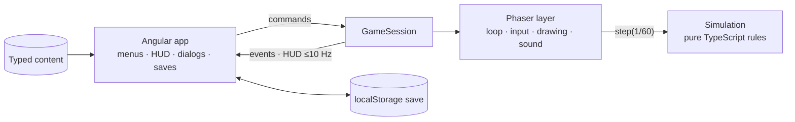

# OLYMPUS UNBOUND

*Unleash the gods. Survive the divine war.*

An original mythological horde-survival roguelite that runs entirely in the browser. Choose a god, enter a procedurally generated realm, survive ever-larger hordes, combine weapons, armour, relics and skills into synergies, defeat the realm's boss, and spend your rewards on lasting upgrades — then go again.

**Now:** a night-lit, dark-fantasy presentation (dynamic lighting, fog, braziers, an ornate stone-and-iron UI), an in-engine intro scene, and a pre-rendered cast of Greek myth — Zeus, satyrs, harpies, Stymphalian birds, centaurs, minotaurs, fallen oracles, marble sentinels and the Cyclops — rendered in Blender from licensed Flare models (`art/blender/`), with walk cycles that keep pace with movement and the Cinzel display font.

**Vertical slice:** Zeus · Mount Olympus · 8 weapons · 4 armour · 6 relics · 16 skills · 7 synergies · 8 enemy types · elites · the Cyclops · run summary · permanent upgrades · codex · keyboard and gamepad.

## Play it locally

Prerequisite: [Node.js 24](https://nodejs.org/).

```bash
cd client
npm ci
npm start          # http://localhost:4200
```

WASD/arrows or a gamepad to move, Space (A) for Zeus's *Wrath of Olympus*, Esc (Start) to pause, 1–3 to pick upgrades.

Checks (CI runs the same on every push and pull request):

```bash
cd client
npm run check      # format, lint, unit tests, production build
npm run e2e        # plays the vertical slice in Chromium (npx playwright install chromium once)
```

`npm run build` produces a static site in `client/dist/olympus-unbound/browser` that any static host can serve.

## Architecture at a glance



- **Angular owns the application**, **Phaser hosts and draws the game**, and a **Phaser-free simulation owns every gameplay rule** — testable in Node, deterministic per seed.
- **Content is typed data**; new weapons, enemies, relics or realms reuse behaviors instead of new code.
- **No backend**: progress is a versioned save in the browser.

| Area | Technology |
|---|---|
| Application | Angular 22 (standalone, signals, zoneless) |
| Game | Phaser 4 + TypeScript simulation core |
| Tests | Vitest, Playwright |
| Workflow | [OpenSpec](https://github.com/Fission-AI/OpenSpec) |

## Repository

```text
client/     Angular app (src/app), engine (src/engine), content (src/content), Playwright tests (e2e)
docs/       product vision, architecture, gameplay, systems, content, decisions
openspec/   capability specs and change proposals
.claude/    OpenSpec commands and skills for Claude Code
```

| Document | Contents |
|---|---|
| [docs/product-vision.md](docs/product-vision.md) | Vision, pillars, roadmap |
| [docs/architecture.md](docs/architecture.md) | Layers, boundary, frame, state ownership, testing, performance |
| [docs/gameplay.md](docs/gameplay.md) | The game as the player sees it |
| [docs/systems.md](docs/systems.md) | Rules and formulas |
| [docs/content.md](docs/content.md) | Content files, checklists, assets and licences, balance notes |
| [docs/art-direction.md](docs/art-direction.md) | The look: light, colour, forms, UI, packs, originality |
| [art/blender/README.md](art/blender/README.md) | How the characters are rendered: sources, licences, scripts |
| [docs/decisions.md](docs/decisions.md) | Binding decisions D1–D14 |
| [CLAUDE.md](CLAUDE.md) | Rules for the AI development agent |

## How work is done

Spec → plan → implement → validate → playtest → iterate, one OpenSpec change at a time (`openspec/changes/<id>/`). The vertical slice was the change `add-vertical-slice`, archived in [`openspec/changes/archive/2026-10-10-add-vertical-slice`](openspec/changes/archive/2026-10-10-add-vertical-slice); its requirements now live in [`openspec/specs/`](openspec/specs/).

## Originality

OLYMPUS UNBOUND is an original game inspired by the *genre* of horde-survival roguelites and by mythology. The characters are rendered by this project from CC-BY 3.0 models of the Flare collection (credited in Settings → Credits); the world, effects, UI art and all sound are generated by the game's own code. Every external file needs a recorded, allowed licence (`npm run assets:check`, credited in Settings → Credits and [docs/content.md](docs/content.md)). No assets, names, UI or code are taken from other games. Name and tagline are provisional; trademark availability has not been checked.
