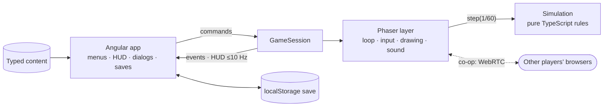

# OLYMPUS UNBOUND

*Unleash the gods. Survive the divine war.*

An original mythological horde-survival roguelite that runs entirely in the browser. Choose a god, survive ever-larger hordes in procedurally generated realms of Greek myth, combine weapons, armour, relics and skills into synergies, defeat each realm's boss and pass its gate into the next, harder realm. The run goes on until every god has fallen; then spend your rewards on lasting upgrades and go again. Play alone, with up to three friends on one screen, or in a co-op room joined by code.


- **Four gods:** Zeus, Hades, Poseidon and Athena, each with a starting weapon, a divine ability, a passive and an arsenal of their own (Thunderbolt is Zeus's alone, the Soul Scythe Hades's).
- **Sprint and dash:** a stamina bar under your health; sprint away, or dash through an attack untouched.
- **Five realms, endless runs:** Mount Olympus, the Underworld, the Lernaean Marsh, the Aegean Shore and the Labyrinth of Crete. Each has its own map, monsters and boss: the Cyclops, Cerberus, the Hydra, Scylla and Asterion. After the Labyrinth comes Olympus again, harder.
- **Build a god:** 10 weapons, 4 armours, 6 relics, 16 skills and 7 synergies; permanent upgrades and a codex between runs.
- **The Wandering Merchant:** twice a realm, trade the run's gold for companions (an eagle, a hound, a serpent) that fight beside you, whetstones and ambrosia.
- **Glory:** a score for every run, solo and co-op high scores, 18 achievements and three daily quests.
- **Co-op:** up to four players on one screen (keyboard and gamepads, one camera that zooms out to frame everyone), or in rooms peer to peer; difficulty per player; a living ally revives a fallen god by standing beside their spirit.
- **Allies:** no friends online? Add up to three gods played by the machine (Easy, Normal or Hard) to a solo run.
- **Night and myth:** dynamic light, fog and torchlight, and a cast rendered in Blender from licensed models (`art/blender/`).

| Every realm's boss | Level up | The gate onward |
|---|---|---|
|  |  |  |
| **The Wandering Merchant** | **Companions at your side** | **The Hall of Glory** |
|  |  |  |

**Play it:** [david-letonja-ctg.github.io/Olympus-Unbound](https://david-letonja-ctg.github.io/Olympus-Unbound/), or download the game from [Releases](https://github.com/David-Letonja-CTG/Olympus-Unbound/releases)

**More:** [Gameplay](docs/gameplay.md) (the loop, gods, realms, bosses, co-op) · [Systems](docs/systems.md) (rules and formulas) · [Architecture](docs/architecture.md) (layers, frame, state) · [Content](docs/content.md) (adding gods, enemies, realms)

## Play it locally

Prerequisite: [Node.js 24](https://nodejs.org/).

```bash
cd client
npm ci
npm start          # http://localhost:4200
```

WASD/arrows or a gamepad to move, Shift (LB) to sprint, E (B) to dash, Space (A) for the god's divine ability, Esc (Start) to pause, 1–3 to pick upgrades.

Checks (CI runs the same on every push and pull request):

```bash
cd client
npm run check      # format, lint, asset licences, unit tests, production build
npm run e2e        # plays the game in Chromium, solo and in a co-op room (npx playwright install chromium once)
```

`npm run build` produces a static site in `client/dist/olympus-unbound/browser` that any static host can serve. Publishing a GitHub Release puts it live on GitHub Pages and attaches it to the release as a zip ([docs/hosting.md](docs/hosting.md)).

## Architecture at a glance



- **Angular owns the application**, **Phaser hosts and draws the game**, and a **Phaser-free simulation owns every gameplay rule**. The rules are testable in Node and deterministic per seed.
- **Content is typed data**: new weapons, enemies, relics or realms reuse behaviors instead of new code.
- **No backend**: progress is a versioned save in the browser. Co-op rooms connect browsers directly, and the host's simulation is the authority.

| Area | Technology |
|---|---|
| Application | Angular 22 (standalone, signals, zoneless) |
| Game | Phaser 4 + TypeScript simulation core |
| Co-op | WebRTC via PeerJS |
| Art | Blender renders of CC-BY / CC0 models, code-drawn world and effects |
| Tests | Vitest, Playwright |
| Workflow | [OpenSpec](https://github.com/Fission-AI/OpenSpec) |

## Repository

```text
client/     Angular app (src/app), engine (src/engine), content (src/content), Playwright tests (e2e)
art/        Blender scripts that render the characters (art/blender)
docs/       product vision, architecture, gameplay, systems, content, art direction, decisions, images
openspec/   capability specs and change proposals
.claude/    OpenSpec commands and skills for Claude Code
```

| Document | Contents |
|---|---|
| [docs/product-vision.md](docs/product-vision.md) | Vision, pillars, roadmap |
| [docs/architecture.md](docs/architecture.md) | Layers, boundary, frame, state ownership, testing, performance |
| [docs/gameplay.md](docs/gameplay.md) | The game as the player sees it |
| [docs/systems.md](docs/systems.md) | Rules and formulas |
| [docs/content.md](docs/content.md) | Content files, checklists, assets and licences, balance notes |
| [docs/art-direction.md](docs/art-direction.md) | The look: light, colour, forms, UI, packs, originality |
| [art/blender/README.md](art/blender/README.md) | How the characters are rendered: sources, licences, scripts |
| [docs/hosting.md](docs/hosting.md) | Releases, GitHub Pages, hosting the zip elsewhere |
| [docs/decisions.md](docs/decisions.md) | Binding decisions |
| [CLAUDE.md](CLAUDE.md) | Rules for the AI development agent |

Pictures in the docs are generated from the running game by [`client/scripts/docs-media/capture.mjs`](client/scripts/docs-media/capture.mjs); rerun it when something visible changes.

## How work is done

Spec → plan → implement → validate → playtest → iterate, one OpenSpec change at a time (`openspec/changes/<id>/`). When a change is done it is archived (`openspec/changes/archive/`) and its requirements merge into the capability specs in [`openspec/specs/`](openspec/specs/).

## Originality

OLYMPUS UNBOUND is an original game inspired by the *genre* of horde-survival roguelites and by Greek mythology. The characters are rendered by this project from CC-BY 3.0 models of the Flare collection and CC0 models (credited in Settings → Credits); the world, effects, UI art and all sound are generated by the game's own code. Every external file needs a recorded, allowed licence (`npm run assets:check`, credited in Settings → Credits and [docs/content.md](docs/content.md)). No assets, names, UI or code are taken from other games. Name and tagline are provisional; trademark availability has not been checked.
