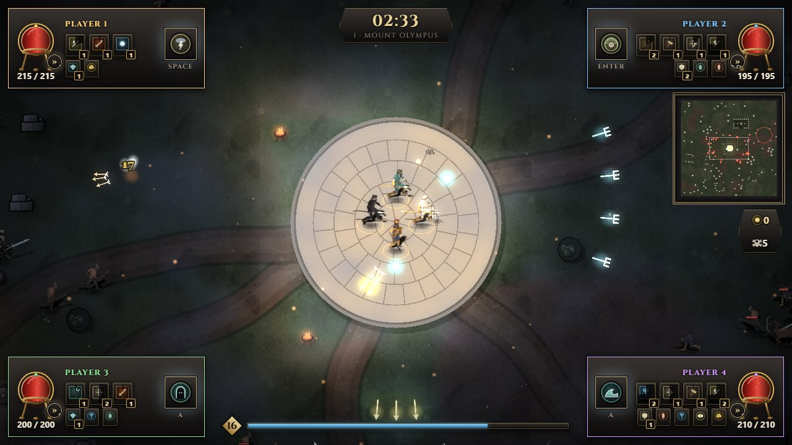
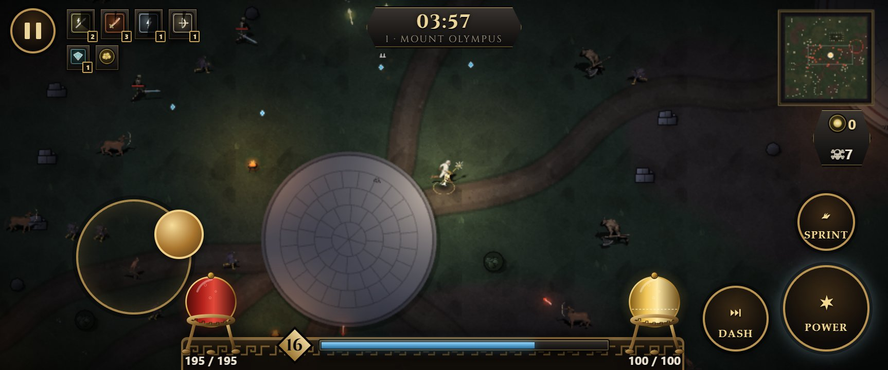
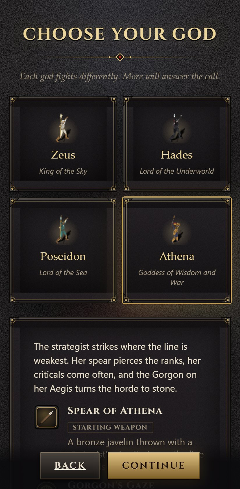
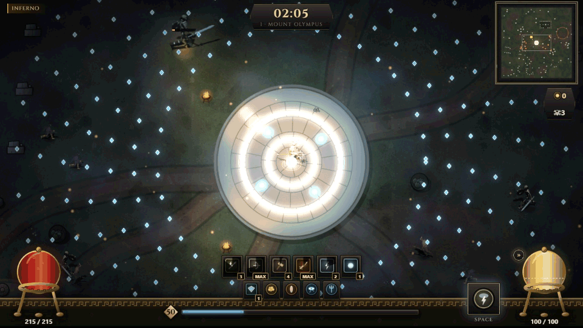
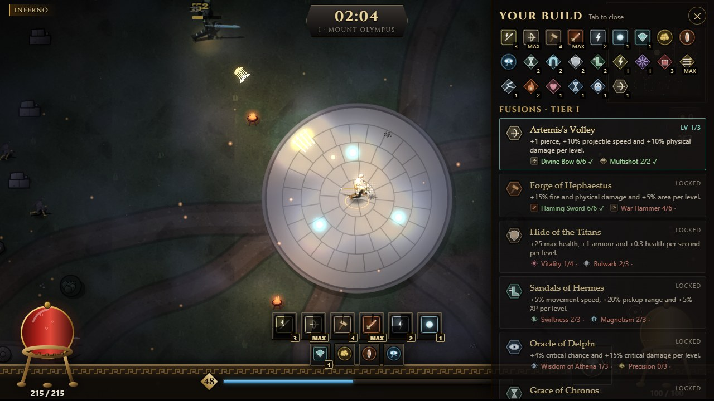

# OLYMPUS UNBOUND

*Unleash the gods. Survive the divine war.*

An original mythological horde-survival roguelite that runs entirely in the browser. Choose a god, survive ever-larger hordes in procedurally generated realms of Greek myth, combine weapons, armour, relics and skills into synergies and fusions, defeat each realm's boss and pass its gate into the next, harder realm. The run goes on until every god has fallen; then spend your rewards on lasting upgrades and go again. Play alone, with up to three friends on one screen, or in a co-op room joined by code.


- **Four gods:** Zeus, Hades, Poseidon and Athena, each with a starting weapon, a divine ability, a passive and an arsenal of their own (Thunderbolt is Zeus's alone, the Soul Scythe Hades's).
- **Daily Trial:** one run a day, the same for everyone: a god, a realm, a seed and a twist such as Swift Foes or Glass God. Your best today is kept, and any run can be shared as a picture and a challenge link that starts the same run for a friend. Co-op rooms have **Invite** links that open the room ready to join.
- **Quick runs:** realms at twice the pace, with the boss at 3:30 instead of 7:00, and their own high-score table. Made for a break on the phone.
- **Sprint and dash:** an orb of golden ichor beside your orb of blood; sprint away, or dash through an attack untouched.
- **Five realms, endless runs:** Mount Olympus, the Underworld, the Lernaean Marsh, the Aegean Shore and the Labyrinth of Crete. Each has its own map, monsters and boss: the Cyclops, Cerberus, the Hydra, Scylla and Asterion. Every realm cleared makes the next much harder: monster and boss health and damage multiply, more come, and the horde is there from the start. After the Labyrinth comes Olympus again, harder still.
- **Bosses with a signature:** the Cyclops rages, Cerberus fights with three heads, the Hydra's heads must fall in order, Scylla's tentacles hold the ground and Asterion shifts the Labyrinth's walls. Every attack is telegraphed, and a dash at the last moment is a perfect dodge.
- **Battle music:** composed in code, it grows from calm to metal as the realm's boss draws near, the horde closes in and the realms go by.
- **Build a god:** 10 weapons, 4 armours, 6 relics, 16 skills and 7 synergies; permanent upgrades and a codex between runs.
- **A tree of fusions:** upgrades at their top level fuse into 14 fusions in three tiers, from *Forge of Hephaestus* (Flaming Sword and War Hammer at level 6) up to **Apotheosis**. Endless **Ascensions** fill the choice once little is left, so every level-up still offers three real choices. Level-up offers say what they count toward.
- **The build panel:** press Tab (Back/Select on a gamepad, the hexagon button on a phone) during a run to see your whole build and every fusion and synergy your god can reach, with what is met and the level still needed. The fight goes on behind it.
- **Call of Hermes:** when experience lies out of reach, a level-up may offer it. Every gem in the realm streams to you.
- **The Wandering Merchant:** twice a realm, trade the run's gold for companions (an eagle, a hound, a serpent) that fight beside you, whetstones and ambrosia.
- **Glory:** a score for every run, solo and co-op high scores, 20 achievements and three daily quests.
- **Co-op:** up to four players on one screen (keyboard and gamepads, one camera that zooms out to frame everyone), or in rooms peer to peer; difficulty per player; a living ally revives a fallen god by standing beside their spirit.
- **Allies:** not enough friends? Fill the party up to four with gods played by the machine (Easy, Normal or Hard).
- **A HUD for every party:** a bronze frieze with orbs of blood and ichor, split between two players at one screen, a plaque in each corner for three or four, and medallions for everyone else; nobody shown twice.
- **On a phone:** hold it sideways. A stick appears under your left thumb, Power, Dash and Sprint wait under your right, and the HUD keeps its orbs between them. Fullscreen where the browser allows, Low quality to start with, rooms by touch.
- **Install it:** an installable web app. From the menu (Chrome, Edge, Android) or Safari's Add to Home Screen (iPhone, iPad), it gets its own icon and opens full screen. Once loaded, it plays offline, all but co-op rooms. New versions download in the background and wait for a reload from the menu.
- **Night and myth:** dynamic light, fog and torchlight, and a cast rendered in Blender from licensed models (`art/blender/`).

| Every realm's boss | Level up | The gate onward |
|---|---|---|
|  |  |  |
| **The Wandering Merchant** | **Companions at your side** | **The Hall of Glory** |
|  |  |  |
| **Together on one screen** | **Players and allies** | **Four at one screen** |
|  |  |  |
| **On a phone, sideways** | **Menus upright** | **Call of Hermes** |
|  |  |  |
| **The build panel** | | |
|  | | |

**Play it:** [olympus.138-2-144-201.sslip.io](https://olympus.138-2-144-201.sslip.io/), or download the game from [Releases](https://github.com/David-Letonja-CTG/Olympus-Unbound/releases)

**More:** [Gameplay](docs/gameplay.md) (the loop, gods, realms, bosses, co-op) · [Systems](docs/systems.md) (rules and formulas) · [Architecture](docs/architecture.md) (layers, frame, state) · [Content](docs/content.md) (adding gods, enemies, realms)

## Play it locally

Prerequisite: [Node.js 24](https://nodejs.org/).

```bash
cd client
npm ci
npm start          # http://localhost:4200
```

WASD/arrows or a gamepad to move, Shift (LB) to sprint, E (B) to dash, Space (A) for the god's divine ability, Esc (Start) to pause, 1–3 to pick upgrades. With a second player on the same keyboard, player 1 keeps WASD, Space, left Shift and E, and player 2 takes the arrows, Enter, right Shift and right Ctrl; more players use gamepads. On a phone or tablet: touch the left half of the screen and drag to move, tap Power, Dash and Sprint (on/off) on the right, and the pause button at the top left.

Checks (CI runs the same on every push and pull request):

```bash
cd client
npm run check      # format, lint, asset licences, unit tests, production build
npm run e2e        # plays the game in Chromium: solo, in a co-op room, on an emulated phone, and offline from a production build (npx playwright install chromium once)
```

`npm run build` produces a static site in `client/dist/olympus-unbound/browser` that any static host can serve. Publishing a GitHub Release puts it live on the game server, which serves the game, its rooms and world boards, and attaches it to the release as a zip ([docs/hosting.md](docs/hosting.md)).

## Architecture at a glance


- **Angular owns the application**, **Phaser hosts and draws the game**, and a **Phaser-free simulation owns every gameplay rule**. The rules are testable in Node and deterministic per seed.
- **Content is typed data**: new weapons, enemies, relics or realms reuse behaviors instead of new code.
- **Progress in the browser**: a versioned save, no accounts. A small game server (D21) relays co-op rooms, lists open rooms for Quick Play and keeps the world leaderboards. The host's simulation is the authority, and everything else plays without it.

| Area | Technology |
|---|---|
| Application | Angular 22 (standalone, signals, zoneless) |
| Game | Phaser 4 + TypeScript simulation core |
| Co-op, matchmaking, world boards | Game server: Node.js, Fastify, `ws`, PostgreSQL (`server/`), Docker Compose with Caddy |
| Art | Blender renders of CC-BY / CC0 models, code-drawn world and effects |
| Tests | Vitest, Playwright |
| Workflow | [OpenSpec](https://github.com/Fission-AI/OpenSpec) |

## Repository

```text
client/     Angular app (src/app), engine (src/engine), content (src/content), Playwright tests (e2e)
art/        Blender scripts that render the characters (art/blender)
docs/       product vision, architecture, gameplay, systems, content, art direction, decisions, images
openspec/   capability specs and change proposals
.claude/    OpenSpec commands and skills for Claude Code
```

| Document | Contents |
|---|---|
| [docs/product-vision.md](docs/product-vision.md) | Vision, pillars, roadmap |
| [docs/architecture.md](docs/architecture.md) | Layers, boundary, frame, state ownership, testing, performance |
| [docs/gameplay.md](docs/gameplay.md) | The game as the player sees it |
| [docs/systems.md](docs/systems.md) | Rules and formulas |
| [docs/content.md](docs/content.md) | Content files, checklists, assets and licences, balance notes |
| [docs/art-direction.md](docs/art-direction.md) | The look: light, colour, forms, UI, packs, originality |
| [art/blender/README.md](art/blender/README.md) | How the characters are rendered: sources, licences, scripts |
| [docs/hosting.md](docs/hosting.md) | Releases, the game server on the VM, hosting the zip elsewhere |
| [docs/decisions.md](docs/decisions.md) | Binding decisions |
| [CLAUDE.md](CLAUDE.md) | Rules for the AI development agent |

Pictures in the docs are generated from the running game by [`client/scripts/docs-media/capture.mjs`](client/scripts/docs-media/capture.mjs); rerun it when something visible changes.

## How work is done

Spec → plan → implement → validate → playtest → iterate, one OpenSpec change at a time (`openspec/changes/<id>/`). When a change is done it is archived (`openspec/changes/archive/`) and its requirements merge into the capability specs in [`openspec/specs/`](openspec/specs/).

## Originality

OLYMPUS UNBOUND is an original game inspired by the *genre* of horde-survival roguelites and by Greek mythology. The characters are rendered by this project from CC-BY 3.0 models of the Flare collection and CC0 models (credited in Settings → Credits); the world, effects, UI art and all sound are generated by the game's own code. Every external file needs a recorded, allowed licence (`npm run assets:check`, credited in Settings → Credits and [docs/content.md](docs/content.md)). No assets, names, UI or code are taken from other games. Name and tagline are provisional.

**Trademark (preliminary check, 2026-10-20, not legal advice):**
- No registration or application for "Olympus Unbound" in TMview (EUIPO, USPTO, WIPO and the national offices), and no commercial game by that name.
- Both words are common in game marks: Olympus Corporation's marks, and games such as Olympus Rising and Olympus Quest; an EU mark UNBOUND (classes 9, 28, 41). So the name is protectable only as a whole.
- `olympusunbound.com` is parked by its owner; the .net, .io and .si domains looked free.
- Before relying on the name, confirm it with a trademark attorney and file in classes 9 and 41.

## Licence

The **source code** is licensed under the [MIT License](LICENSE). The **name, logo and the project's own art** (rendered sprites, screenshots, the preview image) are not covered by it, and all rights to them are reserved. **Third-party assets** keep their own licences (CC-BY 3.0, CC0, OFL), as credited in the game. Details: [NOTICE.md](NOTICE.md).
