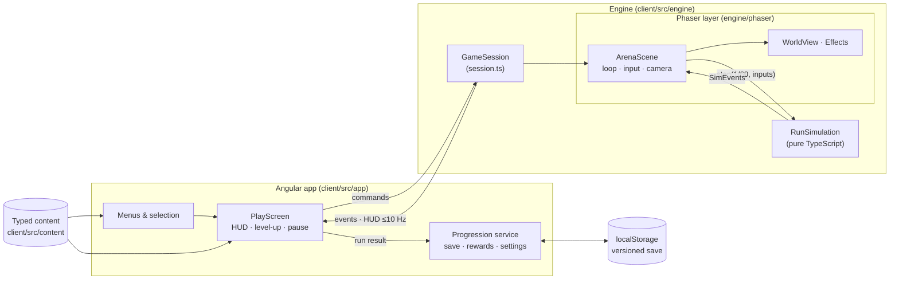
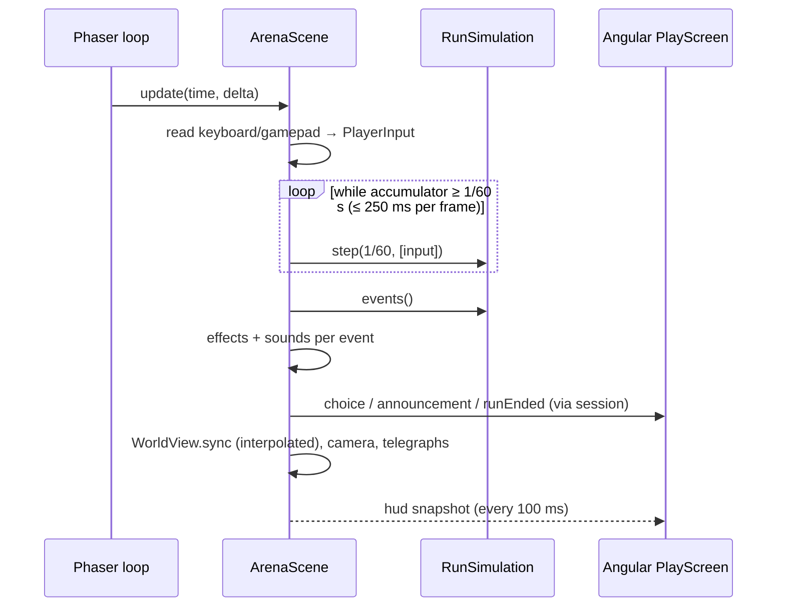

# Architecture

How OLYMPUS UNBOUND is put together. Binding decisions are in [decisions.md](decisions.md) (D1–D11); this page explains how they fit.

## Lineage: what came from Slovion

The structure follows the [Slovion](https://github.com/David-Letonja-CTG/Slovion) repository; its domain, backend and renderer were not reused.

| Slovion concept | OLYMPUS UNBOUND equivalent |
|---|---|
| Angular application (`client/src/app`) | Angular menus, HUD overlay, dialogs, progression, settings, saves |
| Framework-free TypeScript engine (`client/src/engine`) | Phaser-free simulation core + a Phaser layer (`engine/phaser`) for loop, input and drawing |
| Engine ↔ UI boundary (`GameCanvas` + callbacks) | `GameSession`: commands in, events out, ≤ 10 Hz HUD snapshots (D3) |
| ESLint import boundaries (no Angular in the engine) | Same, plus "only `engine/phaser` imports Phaser", "no `Math.random` in the simulation", "Angular uses only `engine/index.ts`" |
| Injectable randomness and clocks | Seeded `Rng` streams, fixed 1/60 s steps (D5) |
| Content as versioned files in `content/` | Typed TypeScript content in `client/src/content/` (D4) |
| OpenSpec `spec-driven` workflow, `/opsx:*` commands | Same workflow and tooling |
| `docs/` (vision, architecture, gameplay, content, decisions) | Same set, plus `systems.md` |
| Vitest unit tests, Playwright E2E, GitHub Actions | Same |
| *Not reused:* .NET backend, PostgreSQL, REST, save tokens, Tiled maps, species/quests/journal, Transloco | Frontend-only (D1), procedural arenas, English-only for now (D10) |

## Overview



## Repository layout

```text
client/
  src/app/                 Angular
    core/                  Progression, RunSetup, SaveStore + save model/rewards, injection tokens, debug flag
    features/              main-menu, god-selection, realm-selection, game (play screen, HUD, dialogs),
                           run-summary, progression, settings
    shared/                item icons, settings controls
  src/engine/              gameplay
    index.ts               public surface — the only engine import Angular and content may use
    session.ts             GameSession contract + createGameSession (lazy-loads Phaser)
    core/                  Rng, vectors, stats/modifiers, spatial hash, collision
    data/                  content schema (types) + ContentIndex + validateContent
    maps/                  value noise + generateArena
    sim/                   RunSimulation, RunState, players, pickups, types/events
    combat/                damage pipeline, status effects
    weapons/               behaviors, stat resolution, weapon/projectile systems
    enemies/               behaviors, enemy system
    bosses/                boss behavior, telegraphed hazards
    spawning/              SpawnDirector
    progression/           loadout, stat refresh, synergies, level-up offers
    art/                   procedural placeholder sprites (Canvas 2D)
    audio/                 synthesized sound cues (Web Audio)
    phaser/                Phaser game, ArenaScene, WorldView, Effects, InputReader, textures
    testing/               fixtures and autopilot for engine tests
  src/content/             gods, weapons, items (armour/relics/skills/synergies), enemies (+ bosses), realms, balance
  e2e/                     Playwright tests
docs/  openspec/  .github/workflows/  .claude/
```

## The session boundary

```ts
createGameSession({ parent, content, run: { runId, godId, realmId, seed, modifiers }, settings, debug })
  → Promise<GameSession>

GameSession.send(command)       pause | resume | chooseUpgrade(choiceId, index) | abandon | updateSettings | debug
GameSession.subscribe(listener) ready | hud | choice | choiceResolved | paused | resumed | announcement | uiInput | runEnded
GameSession.inspect()           debug sessions only (tests)
GameSession.destroy()
```

`createGameSession` dynamically imports the Phaser layer, so the ~1.45 MB Phaser chunk loads only when a run starts (menus: ~310 kB initial). `debug` is true only in development builds opened with `?debug` (used by Playwright).

## A frame



## Simulation step order

`RunSimulation.step` does nothing unless the phase is `playing`. Then, in order: players (movement, collision, regen, ability) → spawn director → enemies (status, behavior or boss, knockback, separation, world collision, contact damage; grid rebuilt) → weapons → projectiles → enemy projectiles → hazards → pickups → remove dead → outcome (**victory before defeat**) → open a pending level-up/chest choice.

## State ownership and phases

| State | Owner |
|---|---|
| Selected god, realm, seed; last run result and rewards | Angular `RunSetup` (memory) |
| Gold, permanent upgrades, codex, statistics, settings | Angular `Progression` over `SaveStore` (localStorage) |
| Run phase, timer, entities, loadout, stats, XP, run gold | `RunSimulation` |
| Sprites, particles, camera, input devices, sounds | Phaser layer |

Application states are routes (`/`, `/gods`, `/realms`, `/play`, `/summary`, `/progression`, `/settings`); guards keep `/play` and `/summary` unreachable without a setup or a result. Run phases: `playing ⇄ choosing`, `playing|choosing → paused → back`, `* → ended` (terminal, entered once).

## Data flow of a run's end

`RunSimulation.end(outcome)` (once) → `runEnded` event → `PlayScreen` ignores repeats → `Progression.recordRun(result)` → pure `applyRunResult` (skips a run ID already processed) → save written → summary.

## Testing

| Level | Tool | What |
|---|---|---|
| Simulation | Vitest (`ng test`), Node + jsdom | RNG, stats, collision, arena generation, damage/status, every weapon and enemy behavior, spawning, offers, synergies, boss attacks, run phases, deterministic replays, headless autopilot runs to victory and defeat, content validation |
| Angular | Vitest + TestBed, stubbed `GAME_SESSION_FACTORY` and storage | save parsing/migration, rewards, progression, screens, guards, PlayScreen ↔ session |
| Browser | Playwright (Chromium, dev server, `?debug`) | the full vertical-slice path, defeat, pause/abandon, buying upgrades and persistence |

## Performance

Targets: 60 fps at 1080p with ~300 enemies. Measured 2026-10-10 (GTX 1660, Chromium, 1920×1080, 331 enemies): **85 fps, worst frame 12 ms**; simulation step **0.8 ms** with ~300 enemies (Node). Means: global caps (400 enemies, 300 projectiles, 400 pickups with XP merging), spatial hashing, in-place compaction of dead entities, image pooling per texture in `WorldView`, ≤ 60 pooled damage numbers, separation limited to 4 neighbours, one Graphics object per effect layer, HUD at 10 Hz.
