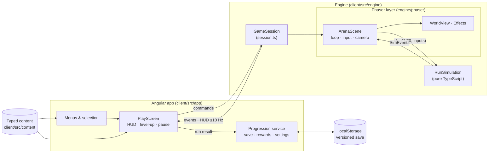
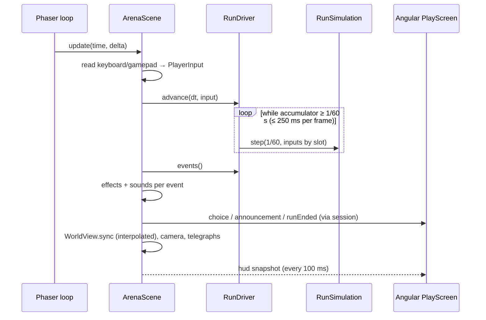
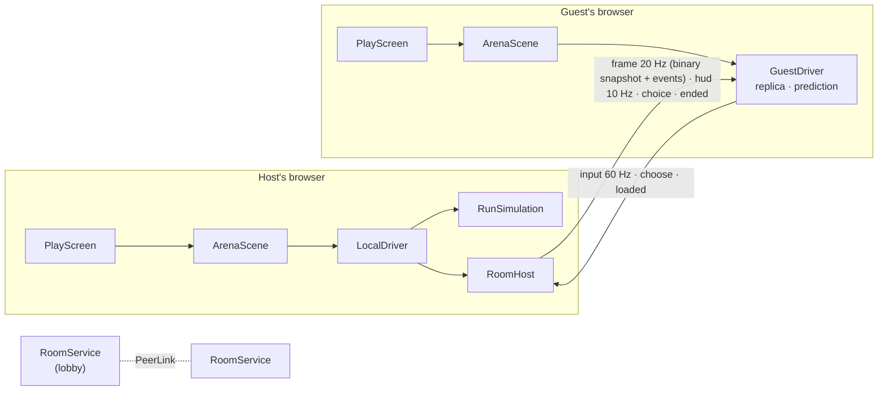

# Architecture

How OLYMPUS UNBOUND is put together. Binding decisions are in [decisions.md](decisions.md) (D1–D11); this page explains how they fit.

## Lineage: what came from Slovion

The structure follows the [Slovion](https://github.com/David-Letonja-CTG/Slovion) repository; its domain, backend and renderer were not reused.

| Slovion concept | OLYMPUS UNBOUND equivalent |
|---|---|
| Angular application (`client/src/app`) | Angular menus, HUD overlay, dialogs, progression, settings, saves |
| Framework-free TypeScript engine (`client/src/engine`) | Phaser-free simulation core + a Phaser layer (`engine/phaser`) for loop, input and drawing |
| Engine ↔ UI boundary (`GameCanvas` + callbacks) | `GameSession`: commands in, events out, ≤ 10 Hz HUD snapshots (D3) |
| ESLint import boundaries (no Angular in the engine) | Same, plus "only `engine/phaser` imports Phaser", "no `Math.random` in the simulation", "Angular uses only `engine/index.ts`" |
| Injectable randomness and clocks | Seeded `Rng` streams, fixed 1/60 s steps (D5) |
| Content as versioned files in `content/` | Typed TypeScript content in `client/src/content/` (D4) |
| OpenSpec `spec-driven` workflow, `/opsx:*` commands | Same workflow and tooling |
| `docs/` (vision, architecture, gameplay, content, decisions) | Same set, plus `systems.md` |
| Vitest unit tests, Playwright E2E, GitHub Actions | Same |
| *Not reused:* .NET backend, PostgreSQL, REST, save tokens, Tiled maps, species/quests/journal, Transloco | Frontend-only (D1), procedural arenas, English-only for now (D10) |

## Overview



## Repository layout

```text
client/
  src/app/                 Angular
    core/                  Progression, RunSetup, SaveStore + save model/rewards/glory, injection tokens, debug and
                           admin flags,
                           rooms (RoomService lobby, RoomNetwork: PeerJS or BroadcastChannel)
    features/              main-menu, god-selection, realm-selection, coop (lobby), game (play screen, HUD,
                           dialogs, loading), run-summary, progression, glory (Hall of Glory), admin (statistics,
                           balance report), settings
    shared/                item icons, settings controls
  src/engine/              gameplay
    index.ts               public surface — the only engine import Angular and content may use
    session.ts             GameSession contract + createGameSession (lazy-loads Phaser)
    core/                  Rng, vectors, stats/modifiers, spatial hash, collision
    data/                  content schema (types, asset manifest, cutscenes) + ContentIndex + validateContent
    maps/                  value noise + generateArena
    sim/                   RunSimulation, RunState, players, pickups, types/events, WorldFrame
    net/                   rooms (D16): PeerLink, protocol, binary snapshots, RunDriver (LocalDriver, GuestDriver),
                           RoomHost
    combat/                damage pipeline, status effects
    weapons/               behaviors, stat resolution, weapon/projectile systems
    enemies/               behaviors, enemy system
    bosses/                boss behavior, telegraphed hazards
    spawning/              SpawnDirector
    progression/           loadout, stat refresh, synergies, level-up offers
    art/                   code-drawn art (Canvas 2D): canvas helpers, characters, world objects, icons
    cutscene/              CutsceneTimeline (pure timing of cutscenes)
    audio/                 synthesized sound cues (Web Audio)
    phaser/                Phaser games: ArenaScene, CutsceneScene, WorldView, Effects, LightMap + Atmosphere,
                           asset loading + SpriteResolver, InputReader, textures
    analysis/              the autopilot bot and BalanceReport (admin mode's balance report)
    testing/               fixtures for engine tests (re-exports the autopilot)
  src/content/             gods, weapons, items (armour/relics/skills/synergies), enemies (+ bosses), realms, balance,
                           assets (external art manifest), cutscenes
  public/ui/               SVG ornaments for the UI (frame, divider, stone grain)
  public/assets/           external art packs (licensed, see docs/content.md)
  scripts/check-assets.mjs licence check for external files
  e2e/                     Playwright tests
docs/  openspec/  .github/workflows/  .claude/
```

## The session boundary

```ts
createGameSession({ parent, content, run: { runId, godId, realmId, seed, modifiers, party? }, settings, debug,
                    room?: { role: 'host', guests } | { role: 'guest', slot, host } })
  → Promise<GameSession>

GameSession.send(command)       pause | resume | chooseUpgrade(choiceId, index) | abandon | updateSettings | debug
GameSession.subscribe(listener) ready | hud | choice | choiceResolved | paused | resumed | announcement | uiInput | runEnded
GameSession.inspect()           debug sessions only (tests)
GameSession.destroy()

createCutsceneSession({ parent, content, cutsceneId, settings }) → Promise<CutsceneSession>
CutsceneSession.subscribe(listener)  loadProgress | ready | captions | uiInput | ended
CutsceneSession.skip() / destroy()
```

`createGameSession` dynamically imports the Phaser layer, so the ~1.45 MB Phaser chunk loads only when a run starts (menus: ~375 kB initial); PeerJS (~90 kB) loads only when a room is opened or joined. `debug` is true only in development builds opened with `?debug` (used by Playwright).

## A frame



## Presentation layers (D12, D13)

Drawing order in a run, back to front:

```text
ground image + grain → marble plazas → cliff shadow → decorations → shadows → elite/boss auras
→ y-sorted world (obstacles, enemies) → fog → LIGHT MAP (multiply) → embers
→ readability layer: enemy copies, telegraphs, pickups, player ring → player → projectiles → effects
→ bars, damage numbers, boss pointer → vignette          (Angular HUD above the canvas)
```

- **Assets:** each scene's `preload` queues the manifest's files and reports `loadProgress`; `SpriteResolver` answers per sprite key with the pack frame/animation or the code-drawn texture (2× resolution, shown at half scale).
- **Light map:** a screen-sized dynamic texture cleared to the realm's ambient colour; every light this frame (player, braziers, strikes, chains, novas, fire, projectiles, elites, boss, chests) is stamped additively, nearest first, up to the quality budget; the result is multiplied over the world. The view rectangle is computed from the camera target (`viewAround`) so the light map never lags a frame.
- **Atmosphere:** two drifting fog layers, embers around the camera, a vignette, and camera filters (colour grade, bloom with a high threshold) switched by quality.
- **Quality profiles** (`phaser/atmosphere.ts`): Low 16 lights at ¼ resolution, no fog/embers/bloom/grade; Medium 48 lights; High 96 lights at ½ resolution with denser fog and embers.

## Loading a run

`ArenaScene` loads in stages and emits `loadProgress` with a `stage`: `art` (Phaser's loader, the asset manifest), `realm` (`GroundBuilder` paints the arena's ground a few rows per frame within a 10 ms budget — base colours from the pure `GroundPainter` in `engine/maps/ground.ts`, then grass, roads and shading on a canvas) and `scene` (the `WorldView`, light map and atmosphere are built). Only then does it emit `ready` and start stepping the simulation, so a run starts at 00:00. `PlayScreen` shows `RunLoading` (realm, party, stage, tips) until `ready` and fades it out. The ground's resolution follows the graphics quality (`GROUND_SCALE`).

**Between realms** (spec: endless-run): travel happens inside a simulation step. `RunState.enterRealm` swaps the realm, arena and collision, and `realmEntered` follows.
- **Host:** `LocalDriver` stops stepping (not loaded) and `RoomHost.newRealm` sends a `waiting` frame at once. `ArenaScene` emits `realmEntered` to Angular and calls `scene.restart()`. `create` rebuilds the realm through the same stages, drops the old ground texture and calls `markLoaded` again. Assets, textures and animations already exist, so `preload` is quick.
- **Guests:** a snapshot with a larger `depth` makes the guest rebuild the same realm and arena (`realmAt`, `realmSeed`). It drops its buffered frames and prediction, emits its own `realmEntered`, and reports `loaded { depth }` when its scene is ready. The host resumes when every guest has loaded that depth.

## Rooms (D16)



- **Lobby** (`app/core/rooms/room-service.ts`): the host opens a room through a `RoomNetwork` and keeps the member list (seat, name, god, ready). Guests send `hello` (with the room version: protocol, snapshot format and a hash of the content), then `update`s. `start` gives every member the same run ID, realm, seed and party in seat order. `RoomNetwork` is PeerJS in production (`peer-network.ts`, a lazy chunk) or a `BroadcastChannel` between tabs with `?debug&net=local` (E2E). The session receives the links as `RoomSeat` (`room` in `GameSessionOptions`).
- **Driver:** `ArenaScene` runs on a `RunDriver` (`engine/net/driver.ts`). `LocalDriver` steps the simulation (solo, or with a `RoomHost` for a host). `GuestDriver` (`engine/net/guest.ts`) builds a `WorldFrame` between the two snapshots around *newest − 100 ms*, and releases each frame's events when the drawn time reaches it. It moves the guest's own god at once with the same movement and collision rules, and corrects it by the host's error at the acknowledged input. The views (`WorldView`, `Effects`) read only `WorldFrame`, which `RunState` satisfies as it is.
- **Host:** `RoomHost` (`engine/net/host.ts`) applies each guest's inputs one per step, in order (none queued: the god stands still). It routes each choice to its player and sends frames, HUDs (every 10th with the result so far) and `ended`. A closed link calls `RunSimulation.leave`.
- **Loading:** after the scene is built, a room's run waits in the `party` stage until every guest has loaded (host) or the first frame has come (guest). In rooms, pause and lost focus do not stop the run.

## Cutscenes (D14)

`CutsceneTimeline` answers which cues fire between two times, the eased camera and fade at a time, and the active captions. `CutsceneScene` builds the realm's arena from the scene's seed and plays cues (spawn, move, remove, horde, strike, light, burst, shake, sound) with the same `WorldView`, `LightMap`, `Atmosphere` and `Effects` as a run; no simulation runs. `IntroScreen` (route `/intro`) shows loading, captions and the skip prompt; the root route's guard sends a player who has not seen the intro there once per page load.

## Simulation step order

`RunSimulation.step` does nothing unless the phase is `playing`. Then, in order: players (movement, collision, regen, ability) → revives → spawn director → enemies (status, behavior or boss, knockback, separation, world collision, contact damage; grid rebuilt) → weapons → projectiles → enemy projectiles → hazards → pickups → remove dead → a fallen boss opens the gate (its gold counts even if the party falls in the same step) → defeat when every god is down → the gate (standing, countdown, travel) → open a pending level-up/chest choice.

## State ownership and phases

| State | Owner |
|---|---|
| Selected god, realm, seed; last run result and rewards | Angular `RunSetup` (memory) |
| Gold, permanent upgrades, codex, statistics, settings (incl. graphics quality), intro seen | Angular `Progression` over `SaveStore` (localStorage) |
| Run phase, timer, entities, loadout, stats, XP, run gold | `RunSimulation` |
| Sprites, particles, camera, input devices, sounds | Phaser layer |

Application states are routes (`/`, `/gods`, `/realms`, `/coop`, `/play`, `/summary`, `/progression`, `/settings`); guards keep `/play` and `/summary` unreachable without a setup (or a room's started run) or a result. A room's lobby lives in `RoomService` (memory) and lasts until its run ends. Run phases: `playing ⇄ choosing`, `playing|choosing → paused → back`, `* → ended` (terminal, entered once).

## Data flow of a run's end

`RunSimulation.end(outcome)` (once) → `runEnded` event → `PlayScreen` ignores repeats → `Progression.recordRun(result)` → pure `applyRunResult` (skips a run ID already processed; applies gold, discoveries, statistics and glory: history, high scores, achievements, daily quests) → save written → summary.

## Testing

| Level | Tool | What |
|---|---|---|
| Simulation | Vitest (`ng test`), Node + jsdom | RNG, stats, collision, arena generation, damage/status, every weapon and enemy behavior, spawning, offers, synergies, boss attacks, run phases, co-op, deterministic replays, headless autopilot runs through the gate and to defeat, endless realms and reviving, content validation; rooms over in-memory links (`engine/testing/memory-link.ts`): snapshots, host + guest, prediction, leaving |
| Angular | Vitest + TestBed, stubbed `GAME_SESSION_FACTORY`, `ROOM_NETWORK` and storage | save parsing/migration, rewards, progression, screens, guards, PlayScreen ↔ session, the lobby protocol |
| Browser | Playwright (Chromium, dev server, `?debug`; `E2E_NO_GPU=1` for software rendering) | the intro (first launch, skip, no replay, replay from the menu), the full vertical-slice path, defeat, pause/abandon, buying upgrades and persistence, a room played by two tabs (`net=local`) |
| Assets | `npm run assets:check` | every external file has an allowed licence entry, every entry has a file |

## Performance

Targets: 60 fps at 1080p with ~300 enemies at High. Measured 2026-10-11 (GTX 1660, Chromium, 1920×1080, 331 enemies, lighting and atmosphere on): **High 79 fps, worst frame 14 ms; Medium 78 fps**. Software rendering (no GPU, Low, 960×540, 331 enemies): ~9 fps with the simulation still in real time — enough for CI, not a player target. Simulation step **0.8 ms** with ~300 enemies (Node). Means: global caps (400 enemies, 300 projectiles, 400 pickups with XP merging), spatial hashing, in-place compaction of dead entities, sprite pooling by entity in `WorldView`, a budgeted light map, ≤ 60 pooled damage numbers, separation limited to 4 neighbours, one Graphics object per effect layer, HUD at 10 Hz.
