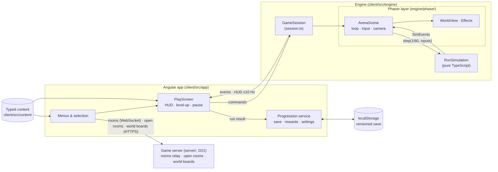
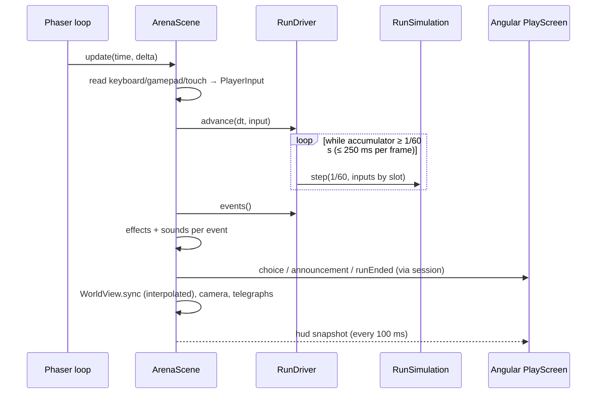
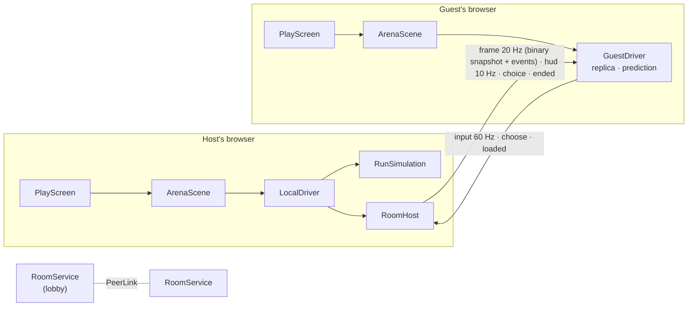
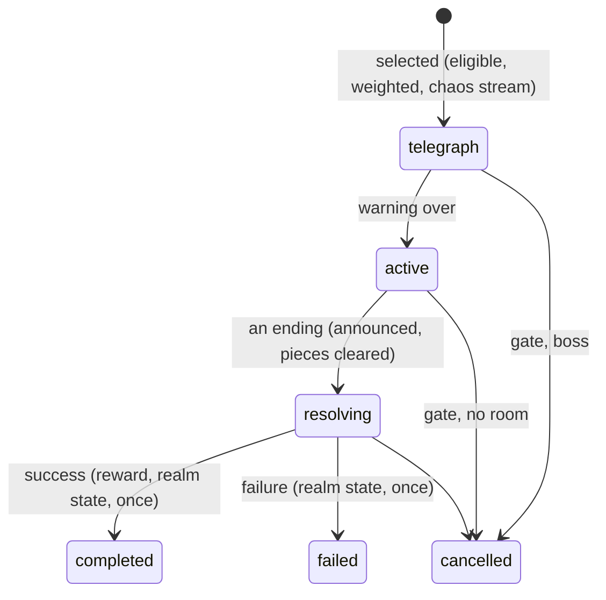
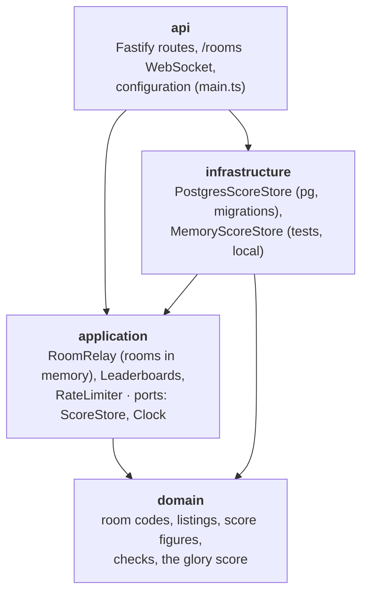
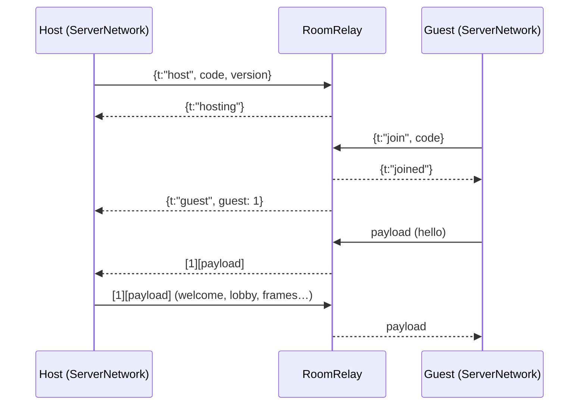

# Architecture

How OLYMPUS UNBOUND is put together. Binding decisions are in [decisions.md](decisions.md) (D1–D11); this page explains how they fit.

## Overview



## Repository layout

```text
client/
  src/app/                 Angular
    core/                  Progression, RunSetup, SaveStore + save model/rewards/glory, injection tokens, debug and
                           admin flags, TouchScreen, the installed app (AppUpdate, InstallPrompt, Connectivity),
                           rooms (RoomService lobby, Quick Play; RoomNetwork: ServerNetwork through the game
                           server, or BroadcastChannel), GameServer (address, requests), WorldScores
    features/              main-menu, god-selection, realm-selection, coop (lobby), game (play screen, HUD,
                           dialogs, loading), run-summary, progression, glory (Hall of Glory), admin (statistics,
                           balance report), settings
    shared/                item icons, settings controls
  src/engine/              gameplay
    index.ts               public surface — the only engine import Angular and content may use
    session.ts             GameSession contract + createGameSession (lazy-loads Phaser)
    core/                  Rng, vectors, stats/modifiers, spatial hash, collision
    data/                  content schema (types, asset manifest, cutscenes) + ContentIndex + validateContent
    maps/                  value noise + generateArena
    sim/                   RunSimulation, RunState, players, movement, pickups, merchant (shop, wares), companions,
                           types/events, WorldFrame
    net/                   rooms (D16): PeerLink, protocol, binary snapshots, RunDriver (LocalDriver, GuestDriver),
                           RoomHost
    combat/                damage pipeline, status effects
    weapons/               behaviors, stat resolution, weapon/projectile systems
    enemies/               behaviors, enemy system
    bosses/                boss behavior, telegraphed hazards
    spawning/              SpawnDirector
    chaos/                 the Director of Chaos: Observer (pressure), ChaosDirector (pacing, selection, lifecycle,
                           realm state, report), ENCOUNTER_BEHAVIORS, boons
    progression/           loadout, stat refresh, synergies, level-up offers
    art/                   code-drawn art (Canvas 2D): canvas helpers, characters, world objects, icons
    cutscene/              CutsceneTimeline (pure timing of cutscenes)
    audio/                 sound cues (recordings and Web Audio synthesis) and the adaptive battle music
    phaser/                Phaser games: ArenaScene, CutsceneScene, WorldView, Effects, LightMap + Atmosphere,
                           asset loading + SpriteResolver, InputReader + TouchControls, textures
    analysis/              the autopilot bot and BalanceReport (admin mode's balance report)
    testing/               fixtures for engine tests (re-exports the autopilot)
  src/content/             gods, weapons, items (armour/relics/skills/synergies), enemies (+ bosses), realms, balance,
                           assets (external art manifest), cutscenes
  public/ui/               SVG ornaments for the UI (frame, divider, stone grain)
  public/assets/           external art packs (licensed, see docs/content.md)
  scripts/check-assets.mjs licence check for external files
  scripts/perf/phone.mjs   frame times of a full horde under phone emulation (see Performance)
  scripts/serve-dist.mjs   serves a production build (the offline e2e test)
  scripts/pwa-icons.mjs    renders the installed app's icons
  ngsw-config.json         what the service worker keeps (D18)
  public/manifest.webmanifest, public/icons/   the installable app
  e2e/                     Playwright tests
server/                    the game server (D21)
  src/domain/              room codes, listings, score figures and their checks (pure)
  src/application/         RoomRelay, Leaderboards, RateLimiter; ports (ScoreStore, Clock)
  src/infrastructure/      PostgresScoreStore + migrations, MemoryScoreStore
  src/api/                 Fastify app (HTTP routes), the /rooms WebSocket, main (configuration)
deploy/                    the image (the game and its server), its container and Caddy site on the VM, install.sh,
                           smoke test, and a stand-in host stack for testing (test/)
docs/  openspec/  .github/workflows/  .claude/
```

## The session boundary

```ts
createGameSession({ parent, content, run: { runId, godId, realmId, seed, modifiers, party? }, settings, debug,
                    room?: { role: 'host', guests } | { role: 'guest', slot, host } })
  → Promise<GameSession>

GameSession.send(command)       pause | resume | chooseUpgrade(choiceId, index) | abandon | updateSettings | debug
GameSession.subscribe(listener) ready | hud | choice | choiceResolved | paused | resumed | announcement | uiInput | runEnded
GameSession.inspect()           debug sessions only (tests)
GameSession.destroy()

createCutsceneSession({ parent, content, cutsceneId, settings }) → Promise<CutsceneSession>
CutsceneSession.subscribe(listener)  loadProgress | ready | captions | uiInput | ended
CutsceneSession.skip() / destroy()
```

`createGameSession` dynamically imports the Phaser layer, so the ~1.45 MB Phaser chunk loads only when a run starts (menus: ~375 kB initial); the room network loads only when a room is opened or joined. `debug` is true only in development builds opened with `?debug` (used by Playwright).

## A frame



## Input (D17)

`InputReader` (`engine/phaser/input.ts`) turns devices into one `PlayerInput` per local seat's `ControlScheme`, and into gamepad `UiInput` edges for the menus.

- **Keyboards** are read by `KeyboardEvent.code` from window listeners. Taps shorter than a frame are latched until the simulation has stepped.
- **Gamepads** are read by index.
- **Touch:** `TouchControls` (`engine/phaser/touch-controls.ts`, no Phaser import) is a DOM layer inside the game's parent, above the canvas and below the Angular HUD and dialogs. The game host is its own stacking context, and the HUD has `pointer-events: none`.
  - Pointer events bind each finger to the control it first touched: the stick (left half) or a button.
  - The pure `stickVector` maps a drag to a move: the share of the radius, nothing inside the simulation's dead zone. `followThumb` drags the base behind a thumb past the rim.
  - Taps are latched like keys. Sprint is a toggle.
  - At the HUD's 10 Hz tick, `ArenaScene` passes the ability's cooldown and the dash's affordability to `InputReader.showHud`, which the buttons show.
- **Schemes:** `'touch'` is the touch controls plus the whole keyboard and the first gamepad, as `'keyboard'` has. `PlayScreen` passes `local: ['touch']` when `TouchScreen` (`app/core/touch-screen.ts`) reports a coarse main pointer.
- **The phone screen** (Angular):
  - `TouchScreen` also knows portrait and touch-only devices, and asks for fullscreen and a landscape lock from the taps that start a run. A guest asks on the first touch of the run.
  - `PlayScreen` adds the pause button and the rotate overlay, which pauses a solo run. During a run it blocks scroll, pull to refresh and the long-press menu. Zoom is blocked everywhere: by the viewport (`maximum-scale=1`), by `touch-action: pan-x pan-y` on the page, and in `App` by cancelling Safari's gesture events.

## The installed app (D18)

- **Service worker:** Angular's (`@angular/service-worker`), in production builds only. It is registered once the first screen is idle.
  - `ngsw-config.json` keeps every file of the build in advance (about 11 MB): code, art, sounds, fonts and the styles' `media/`.
  - Navigations are answered with the cached `index.html`, so deep links work offline.
  - Its paths are relative to its own location, so it works under any `--base-href`.
- **Manifest:** `public/manifest.webmanifest`, with `start_url` and `scope` set to `./`. It asks for full screen and landscape, and lists the icons from `scripts/pwa-icons.mjs`. `index.html` links it and adds what iOS reads instead: the touch icon, `apple-mobile-web-app-capable` and the status bar.
- **Services:**
  - `AppUpdate` wraps `SwUpdate`: it checks at launch and every 30 minutes, and the main menu offers to reload. Nothing reloads by itself.
  - `InstallPrompt` keeps Chrome's `beforeinstallprompt` for the menu's button, knows the installed display mode, and recognises iOS Safari.
  - `Connectivity` disables rooms offline.
  - `TouchScreen` asks for no fullscreen in the installed app.
- **Saves** stay in `localStorage` (D8); the worker never touches them.

## Presentation layers (D12, D13)

Drawing order in a run, back to front:

```text
ground image + grain → marble plazas → cliff shadow → decorations → shadows → elite/boss auras
→ y-sorted world (obstacles, enemies) → fog → LIGHT MAP (multiply) → embers
→ readability layer: enemy copies, telegraphs, pickups, player ring → player → projectiles → effects
→ bars, damage numbers, boss pointer → vignette          (Angular HUD above the canvas)
```

- **Assets:** each scene's `preload` queues the manifest's files and reports `loadProgress`; `SpriteResolver` answers per sprite key with the pack frame/animation or the code-drawn texture (2× resolution, shown at half scale).
- **Light map:** a screen-sized dynamic texture cleared to the realm's ambient colour; every light this frame (player, braziers, strikes, chains, novas, fire, projectiles, elites, boss, chests) is stamped additively, nearest first, up to the quality budget; the result is multiplied over the world. The view rectangle is computed from the camera target (`viewAround`) so the light map never lags a frame.
- **Atmosphere:** two drifting fog layers, embers around the camera, a vignette, and camera filters (colour grade, bloom with a high threshold) switched by quality.
- **Quality profiles** (`phaser/atmosphere.ts`): Low 16 lights at ¼ resolution, no fog/embers/bloom/grade, enemies drawn once above the light map with a night tint (no copy, no ground shadow for ordinary ones); Medium 48 lights; High 96 lights at ½ resolution with denser fog and embers.
- **Culling:** enemies further than a margin outside the camera's view get no sprites (their lights still count).

## Loading a run

`ArenaScene` loads in stages and emits `loadProgress` with a `stage`: `art` (Phaser's loader, the asset manifest), `realm` (`GroundBuilder` paints the arena's ground a few rows per frame within a 10 ms budget — base colours from the pure `GroundPainter` in `engine/maps/ground.ts`, then grass, roads and shading on a canvas) and `scene` (the `WorldView`, light map and atmosphere are built). Only then does it emit `ready` and start stepping the simulation, so a run starts at 00:00. `PlayScreen` shows `RunLoading` (realm, party, stage, tips) until `ready` and fades it out. The ground's resolution follows the graphics quality (`GROUND_SCALE`).

**Between realms** (spec: endless-run): travel happens inside a simulation step. `RunState.enterRealm` swaps the realm, arena and collision, and `realmEntered` follows.
- **Host:** `LocalDriver` stops stepping (not loaded) and `RoomHost.newRealm` sends a `waiting` frame at once. `ArenaScene` emits `realmEntered` to Angular and calls `scene.restart()`. `create` rebuilds the realm through the same stages, drops the old ground texture and calls `markLoaded` again. Assets, textures and animations already exist, so `preload` is quick.
- **Guests:** a snapshot with a larger `depth` makes the guest rebuild the same realm and arena (`realmAt`, `realmSeed`). It drops its buffered frames and prediction, emits its own `realmEntered`, and reports `loaded { depth }` when its scene is ready. The host resumes when every guest has loaded that depth.

## Rooms (D16)



- **Lobby** (`app/core/rooms/room-service.ts`): the host opens a room through a `RoomNetwork` and keeps the member list (seat, name, god, ready). Guests send `hello` (with the room version: protocol, snapshot format and a hash of the content), then `update`s. `start` gives every member the same run ID, realm, seed and party in seat order. `RoomNetwork` is `ServerNetwork` (`server-network.ts`, a lazy chunk), through the game server (see below), or a `BroadcastChannel` between tabs with `?debug&net=local` (docs capture). A public lobby publishes its listing (`RoomListing.publish`), and `quickPlay` joins the fullest open room or opens a public one (spec: matchmaking). The session receives the links as `RoomSeat` (`room` in `GameSessionOptions`).
- **Driver:** `ArenaScene` runs on a `RunDriver` (`engine/net/driver.ts`). `LocalDriver` steps the simulation (solo, or with a `RoomHost` for a host). On a shared screen (`GameSessionOptions.local`, one `ControlScheme` per local seat) `InputReader` reads one input per scheme (keys by `KeyboardEvent.code`, gamepads by number), `LocalDriver` passes them in seat order, forwards every local player's choices and accepts their answers, and `focus()`/`spread()` frame the living local gods for the camera. `GuestDriver` (`engine/net/guest.ts`) builds a `WorldFrame` between the two snapshots around *newest − 100 ms*, and releases each frame's events when the drawn time reaches it. It moves the guest's own god at once with the same movement and collision rules, and corrects it by the host's error at the acknowledged input. The views (`WorldView`, `Effects`) read only `WorldFrame`, which `RunState` satisfies as it is.
- **Host:** `RoomHost` (`engine/net/host.ts`) applies each guest's inputs one per step, in order (none queued: the god stands still). It routes each choice to its player and sends frames, HUDs (every 10th with the result so far) and `ended`. A closed link calls `RunSimulation.leave`.
- **Loading:** after the scene is built, a room's run waits in the `party` stage until every guest has loaded (host) or the first frame has come (guest). In rooms, pause and lost focus do not stop the run.

## Cutscenes (D14)

`CutsceneTimeline` answers which cues fire between two times, the eased camera and fade at a time, and the active captions. `CutsceneScene` builds the realm's arena from the scene's seed and plays cues (spawn, move, remove, horde, strike, light, burst, shake, sound) with the same `WorldView`, `LightMap`, `Atmosphere` and `Effects` as a run; no simulation runs. `IntroScreen` (route `/intro`) shows loading, captions and the skip prompt; the root route's guard sends a player who has not seen the intro there once per page load.

## The Director of Chaos

`ChaosDirector` (`engine/chaos/director.ts`, spec: director-of-chaos) lives in `RunSimulation` for the whole run and steps after the spawn director. It owns its encounters, cooldowns, realm state and memory of decisions; the encounters' effects are ordinary run state the other systems already read: monsters it spawns (with `champion` set for hunters), hazards from `placeAttack`, pickups for rewards, `Player.boons` (through `collectModifiers`), `RunState.omen` (enemy speed in the enemy system, spawn rate in the spawn director, darkness for the light map) and `RunState.sites` (markers). Behaviors (`ENCOUNTER_BEHAVIORS`) are one rule per kind; the scheduler never asks which kind it runs.



- **Rooms:** the host's simulation alone directs. Guests get the markers, darkness and champion flag in the snapshot (since format 6; format 7 adds the broken props), the encounters and their blessings in their HUD, and the announcements and `encounter`/`escaped`/`blessed` events in the frames. Stepping into a shrine or altar is any god's position on the host, so no message was added.
- **Presentation:** `Effects` draws markers and champions above the light map with pointers; `LightMap.setDarkness` eases the ambient toward night violet, keeping 40% of it; the minimap marks them; the HUD lists encounters and blessings (`hud.encounters`, `hud.boons`).
- **Debugging:** `DebugAction` `director` (on/off) and `encounter` (start one); `RunSimulation.directorReport()` and `inspect().director`; `?debug&director` shows the report over the run (`DirectorPanel`). `RunRules.director: false` turns it off for a run.

## Run rules and variants

`RunConfig.rules` changes how a run plays on top of the content, as deterministic data (D5):

- `pace` speeds the realm's clock against the run's. The merchant's arrivals follow the realm's clock, and `skipTo` moves the run's clock by the realm time skipped divided by the pace.
- `modifiers` are added to every seat of the party, bots included.

A quick run is `pace: 2` plus `xpGain +1`.

`RunConfig.variant` (`quick`, `daily` or `challenge`) is not read by the simulation. It comes back in `RunResult.variant`, so the application files the result in the right high-score table.


`RunRules.enemies` multiplies every enemy's health, damage and speed when it is created, and the spawn rate in the director.

## Daily Trial and challenges (D19)

- **The trial:** `dailyTrialFor(date, content)` (`app/core/daily-trial.ts`) picks the day's god, realm, seed and twist from the date alone (FNV-1a into a small LCG, as for the daily quests).
  - Twists are content (`content/daily.ts`, `TwistDefinition`), checked by `validateContent`. They change only gods' stats and enemy multipliers.
  - `RunSetup.special` carries the trial, or a challenge, to `PlayScreen`, which starts it solo with `trialRun` / `challengeRun` (rules and variant).
- **Records:** `applyGlory` files a result by `tableOf(result)`. Daily Trials and twisted challenges enter no table. The day's best goes to `SaveData.dailyTrial` (save v8).
- **Sharing:**
  - `drawShareCard` (`app/core/share-card.ts`) paints a 1200 × 630 PNG on a canvas: the player's name as the headline, the god's portrait before the boss's silhouette, the score to beat.
  - The player's name lives in `SaveData.playerName` (save v9); Settings and the Co-op name field write it, and challenge links carry it as `n`.
  - The summary has two buttons, since chat apps such as Messenger keep a share's text and drop its picture. `sharePicture` shares the picture alone (Web Share API with files), else downloads it. `shareLink` shares the dare and the challenge link, else copies them.
  - `scripts/entry-pages.mjs` gives the shared routes (`challenge`, `coop`, `daily`) their own HTML files in the build, so their links answer 200 and chat apps show the preview card.
- **Invites:** `inviteLink` (`app/core/rooms/invite.ts`) makes `coop?join=CODE`; the lobby shares it with `shareLink` (share sheet, else clipboard). The Co-op screen reads `join` through `invitedCode`, fills the code in and waits for a tap: joining stays the player's choice.
  - `challengeLink` / `parseChallenge` (`app/core/challenge.ts`) write and read `challenge?g=…&r=…&s=…[&q=1][&t=…]&b=…`, relative to the base URL. The `/challenge` route opens the challenge, and a broken link goes to the menu.
- **Link preview:** `index.html` carries Open Graph and Twitter tags with absolute URLs on the game's address and `public/og-image.jpg`. The docs-media script's `og` scene renders that image.

## Simulation step order

`RunSimulation.step` does nothing unless the phase is `playing`. Then, in order: players (movement, collision, regen, ability) → revives → spawn director → Director of Chaos (boons, encounters, observation, a decision) → enemies (flow field refresh, status, behavior or boss, knockback, separation, world collision, contact damage; grid rebuilt) → weapons → projectiles → enemy projectiles → hazards → pickups → remove dead → a fallen boss opens the gate (its gold counts even if the party falls in the same step) → defeat when every god is down → the gate (standing, countdown, travel) → open a pending level-up/chest choice.

## State ownership and phases

| State | Owner |
|---|---|
| Selected god, realm, seed; last run result and rewards | Angular `RunSetup` (memory) |
| Gold, permanent upgrades, codex, statistics, settings (incl. graphics quality), intro seen | Angular `Progression` over `SaveStore` (localStorage) |
| Run phase, timer, entities, loadout, stats, XP, run gold | `RunSimulation` |
| Director of Chaos: pressure, encounters under way, cooldowns, realm state (corruption, grudge), decisions; realm modifiers (`omen`), world markers (`sites`), blessings on gods | `ChaosDirector` and `RunState` (simulation, one per run) |
| Sprites, particles, camera, input devices, sounds | Phaser layer |

Application states are routes (`/`, `/gods`, `/realms`, `/coop`, `/play`, `/summary`, `/progression`, `/settings`); guards keep `/play` and `/summary` unreachable without a setup (or a room's started run) or a result. A room's lobby lives in `RoomService` (memory) and lasts until its run ends. Run phases: `playing ⇄ choosing`, `playing|choosing → paused → back`, `* → ended` (terminal, entered once).

## Data flow of a run's end

`RunSimulation.end(outcome)` (once) → `runEnded` event → `PlayScreen` ignores repeats → `Progression.recordRun(result)` → pure `applyRunResult` (skips a run ID already processed; applies gold, discoveries, statistics and glory: history, high scores, achievements, daily quests) → save written → summary.

## Testing

| Level | Tool | What |
|---|---|---|
| Simulation | Vitest (`ng test`), Node + jsdom | the Director of Chaos (determinism, eligibility, pacing and recovery, lifecycle, endings once, cleanup, the grudge chain, adaptive bounds, blessings, contracts, snapshots), RNG, stats, collision, arena generation, damage/status, every weapon and enemy behavior, spawning, offers, synergies, boss attacks, run phases, co-op, deterministic replays, headless autopilot runs through the gate and to defeat, endless realms and reviving, content validation; rooms over in-memory links (`engine/testing/memory-link.ts`): snapshots, host + guest, prediction, leaving |
| Angular | Vitest + TestBed, stubbed `GAME_SESSION_FACTORY`, `ROOM_NETWORK` and storage | save parsing/migration, rewards, progression, screens, guards, PlayScreen ↔ session, the lobby protocol |
| Browser | Playwright (Chromium, dev server, `?debug`; `E2E_NO_GPU=1` for software rendering) | the Daily Trial (from the menu to its summary, Share saving the picture and copying the link, the Hall showing the best, the challenge link starting the same run), a quick run (the boss at 3:30, the Quick table), the installed game offline (a production build served by `scripts/serve-dist.mjs`, whose connections are dropped once the service worker has every file: a deep link, the Co-op screen offline, a solo run), the intro (first launch, skip, no replay, replay from the menu), a run on a phone (Pixel 7 sideways: moving, dashing and pausing by touch, the HUD clear of the thumbs, a choice by tap), the full vertical-slice path, defeat, pause/abandon, buying upgrades and persistence, a room played by two tabs (`net=local`; the guest joins from the host's invite link) |
| Assets | `npm run assets:check` | every external file has an allowed licence entry, every entry has a file |

## Performance

Targets: 60 fps at 1080p with ~300 enemies at High. Measured 2026-10-11 (GTX 1660, Chromium, 1920×1080, 331 enemies, lighting and atmosphere on): **High 79 fps, worst frame 14 ms; Medium 78 fps**. Software rendering (no GPU, Low, 960×540, 331 enemies): ~9 fps with the simulation still in real time — enough for CI, not a player target. Simulation step **0.8 ms** with ~300 enemies (Node). Means: global caps (400 enemies, 300 projectiles, 400 pickups with XP merging), spatial hashing, in-place compaction of dead entities, sprite pooling by entity in `WorldView`, a budgeted light map, ≤ 60 pooled damage numbers, separation limited to 4 neighbours, one shared flow field for the whole horde (refreshed ≤ 10 Hz; about 0.03 ms per step in the Labyrinth, measured 2026-10-21) instead of per-enemy pathfinding, one Graphics object per effect layer, static floor art baked into textures (a Graphics is re-triangulated every frame), HUD at 10 Hz.

**Phones** (measured 2026-10-20 with `node scripts/perf/phone.mjs`, against the development build):

- Setup: Pixel 7 emulation held sideways (863 × 360, touch), CPU slowed 4× through the DevTools protocol, this machine's GPU, Zeus on Mount Olympus with 300–400 enemies.
- Before tuning, at Low: about 18 fps, median frame 50 ms, 95th percentile 100 ms.
- The main thread was saturated. About 80% of it went to drawing (Phaser and the WebGL calls behind it), about 16% to the simulation, and about 10% to the HUD's repainting.
- Tuning, presentation only:
  - The spatial hash's query finds the same items in the same order without a per-query set; the simulation's runs are unchanged.
  - Enemies off screen are not drawn.
  - On Low, enemies are drawn once above the darkness (D13 amended), without ordinary ground shadows.
  - On touch devices, the HUD has no transitions or endless glows.
- After tuning, at Low: **26 fps, median 33 ms, 95th percentile 50 ms**, the simulation in real time. High: 19 fps, median 50 ms.
- 2026-10-22: a profile showed the arena's marble floors (plazas and temples, hundreds of slab lines in one Graphics) re-triangulated every frame, about a quarter of the main thread. They are now drawn once into canvas textures (`WorldView.bake`) and look the same. Low: 29 → **50 fps, median 17 ms, 95th percentile 33 ms**; High: 20 → **28 fps, median 33 ms**.
- Emulation is not a phone: the GPU and the browser differ. Check a real phone before trusting these numbers.

## The game server (D21)

`server/` is one Node.js service in TypeScript, layered as a modular monolith. It serves the game's files, carries rooms, lists open rooms and keeps the world boards. It runs no game rules and holds no saves.



- **Dependencies:** `domain` imports nothing, `application` only `domain`, and `infrastructure` implements `application`'s ports. `api` composes everything. ESLint enforces these rules (`server/eslint.config.js`); tests may cross them.
- **Rooms** (`/rooms`, design: Rooms over WebSocket):
  - **Pairing:** a host's socket opens a code, each guest's socket joins it, and the relay pairs them.
  - **Binary frames** go host → guest as `[u32 guest][payload]` and guest → host as `payload`, which the host receives with the guest's number. The relay never reads a payload.
  - **Codec:** the game encodes its messages with `client/src/app/core/rooms/wire.ts`: JSON plus the snapshots' `ArrayBuffer`s.
  - **Ending:** a room ends with its host, and its guests are closed with code 4001.
- **Limits:** frame size, frames per 5 s, sockets per address, guests per room, and runs per address per hour. Addresses are held in memory only.
- **Routes:**

| Route | What |
|---|---|
| `GET /health` | 200 when the database answers |
| `GET /api/rooms?version=` | open public rooms of a game version, fullest first |
| `POST /api/scores` | a finished run: checked, scored by the server, each run once |
| `GET /api/leaderboards/:board?date=&god=&limit=` | the best of a board (`solo`, `allies`, `coop`, `quick`, `daily` + date) |
| `POST /api/admin/scores/:id/hide` | hides an entry (`Authorization: Bearer ADMIN_TOKEN`) |

**A room through the server:**



**Data:** PostgreSQL holds one table, `scores`: run ID (unique), board and date, names, god, realm, party, figures, score, version, time and a hidden flag. Migrations run at startup (`infrastructure/migrations.ts`). Rooms and listings live only in memory.

**The game's side:**
- `GameServer` (`app/core/game-server.ts`) knows the address from the build (`OLYMPUS_SERVER`). Without one, co-op and the World tables are not offered.
- `WorldScores` sends finished runs (co-op by the host, with the party's names) and queues those it could not send.

**Deployment:** `deploy/` and [hosting.md](hosting.md#the-game-server).
