# Gameplay

The game as the player experiences it. Numbers live in `client/src/content/` and may change with balancing; this page describes the shape.

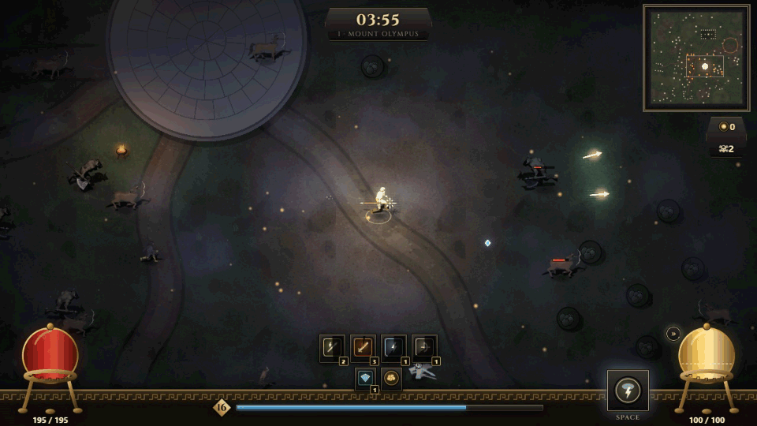

## The loop

0. **Intro** — on first launch, a ~55-second scene: the gods at the altar on a moonlit Olympus, the horde breaking in from the north, the gods falling one by one, and Zeus unleashing the storm. Skip with Esc, Enter, Space, a click or the gamepad; replay it from the main menu (*Intro*).
1. **Main menu** → *Play*, *Co-op*, *Progression*, *Settings*; the gold total is shown.
2. **Choose a god** — Zeus, Hades, Poseidon or Athena (more gods later).
3. **Choose a realm** — where the run starts (Mount Olympus, the Underworld, the Lernaean Marsh, the Aegean Shore or the Labyrinth of Crete), with a seed (random by default; enter one to replay the same arenas).
4. **Survive.** Weapons fire on their own; the player moves, positions, collects XP and uses the divine ability.
5. **Level up** — the run pauses; pick one of three upgrades.
6. **Pressure rises** — new enemy types, packs, hordes and elites.
7. **The boss** — after 7 minutes in a realm its boss wakes in its arena (the Cyclops on Mount Olympus). Defeating it adds its gold and opens a **gate** to the next realm.
8. **Deeper** — step into the gate (or wait a minute) and the party enters the next realm: a new arena, the realm's own monsters from the start of its timeline, everything a little stronger than before. The run goes on realm after realm until every god has fallen.
9. **Run summary** — time, realms cleared, the realm reached, level, kills, gold, rewards, build, discoveries → main menu or play again.
10. **Progression** — spend gold on permanent upgrades; browse the codex.

| Choose a god | Choose a realm | Level up |
|---|---|---|
| 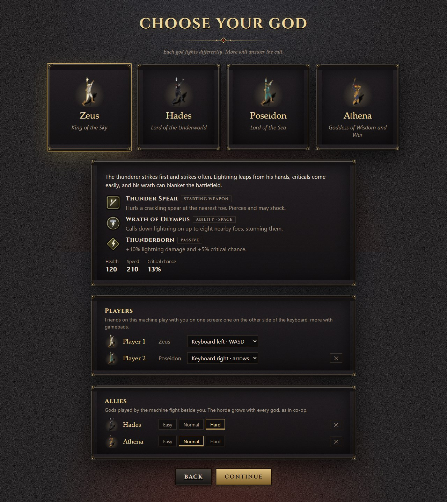 | 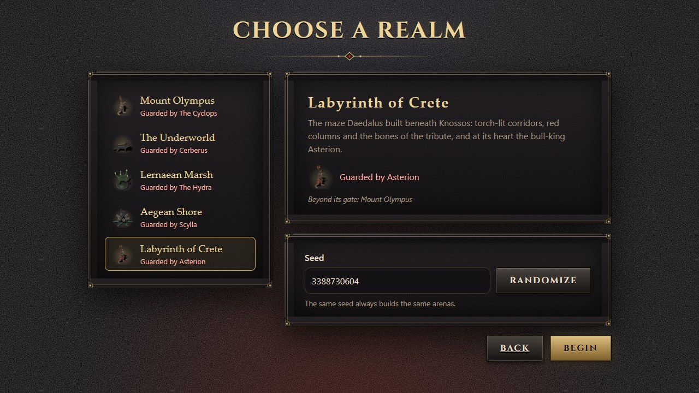 | 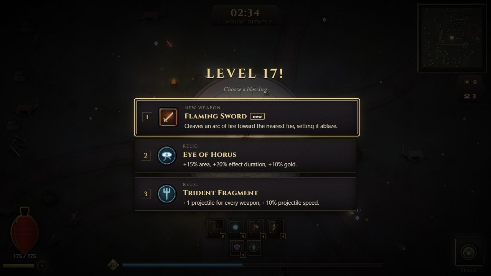 |
| **The gate after a boss** | **The run summary** | **Progression** |
| 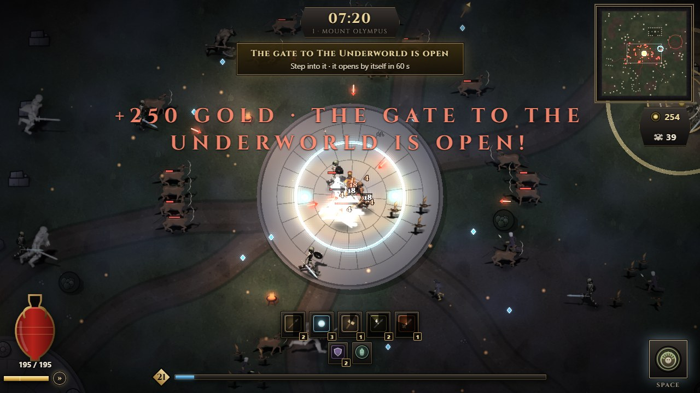 | 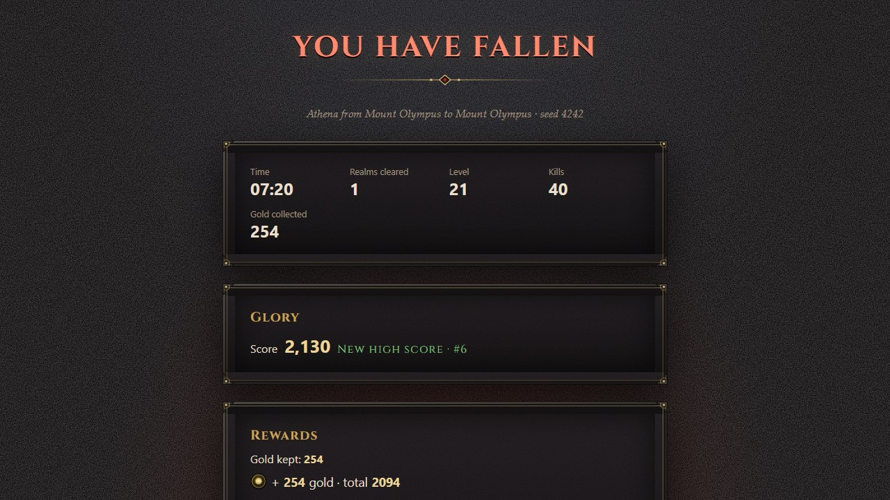 | 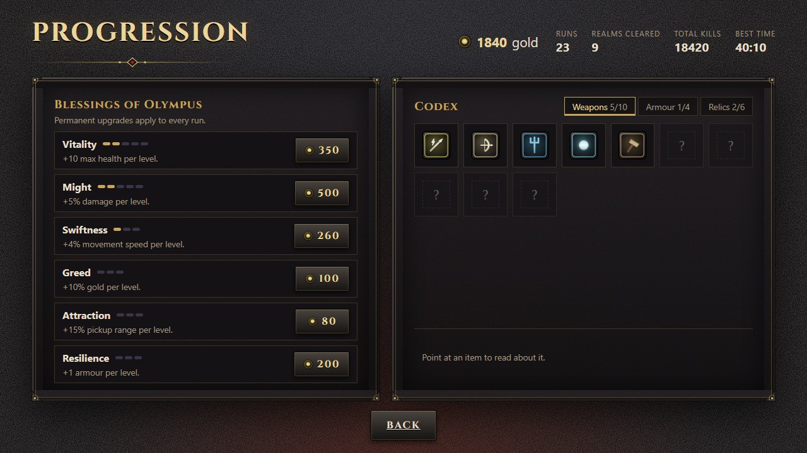 |

## Controls

| Action | Keyboard | Gamepad |
|---|---|---|
| Move | WASD / arrow keys | left stick / d-pad |
| Divine ability | Space | A (south) or right trigger |
| Sprint (uses stamina) | hold Shift | hold left bumper or left trigger |
| Dash (uses stamina, untouchable while dashing) | E | B (east) |
| Pause / resume | Esc or P | Start |
| Choose an upgrade | 1–3, or arrows/W/S + Enter/Space, or mouse | d-pad + A |

The game pauses by itself when the window loses focus or the tab is hidden (not in a room's run).

**Stamina** is the gold bar under the health amphora. Sprinting drains it while you run; a dash costs about a third of it and carries you some 150 units in the blink of an eye, through any attack. It refills once you stop spending it for a moment; running on with Shift held while spent keeps it empty, so let go to catch your breath. The small pip at its end shows when a dash is ready; the mark on the bar shows how much a dash costs.

**Each god has an arsenal.** Some weapons belong to one god (Thunderbolt to Zeus, the Soul Scythe to Hades), some to a few (the Thunder Spear to Zeus, Poseidon and Athena), and the Divine Bow, War Hammer and Flaming Sword to all. You are only ever offered your own god's weapons.

## Allies

Not enough friends? On god selection, **+ Add an ally** brings a god played by the machine, up to three, each set to **Easy**, **Normal** or **Hard**. A run with allies plays like co-op: the horde grows with every god, each ally takes its own upgrades at once (you are never kept waiting), allies revive you and each other by standing beside a fallen spirit, and everyone goes through the gate together. They stay near you, fight at the range that suits their weapons, gather what lies near and leave the merchant to you. Easy allies react slowly and use their ability whenever it is ready; Normal ones step out of telegraphs, dash out of trouble and save the ability for a crowd; Hard ones react almost at once and build on their best weapons. Runs with allies have their own high-score table (*With allies*) and never count as co-op, unless two or more people play (see Local co-op).

## Local co-op

Friends on the same machine play together on one screen. On god selection, **+ Add a player** adds a player with their own god, up to four gods together with any bot allies. Each player picks their controls:

| Controls | Move | Ability | Sprint | Dash |
|---|---|---|---|---|
| Keyboard left | WASD | Space | left Shift | E |
| Keyboard right | arrow keys | Enter or numpad 0 | right Shift | right Ctrl or numpad 1 |
| Gamepad 1–4 | left stick / d-pad | A or right trigger | left bumper or trigger | B |

Player 1 starts on the left of the keyboard and player 2 on the right; players 3 and 4 take gamepads. Choosing controls another player has swaps them.

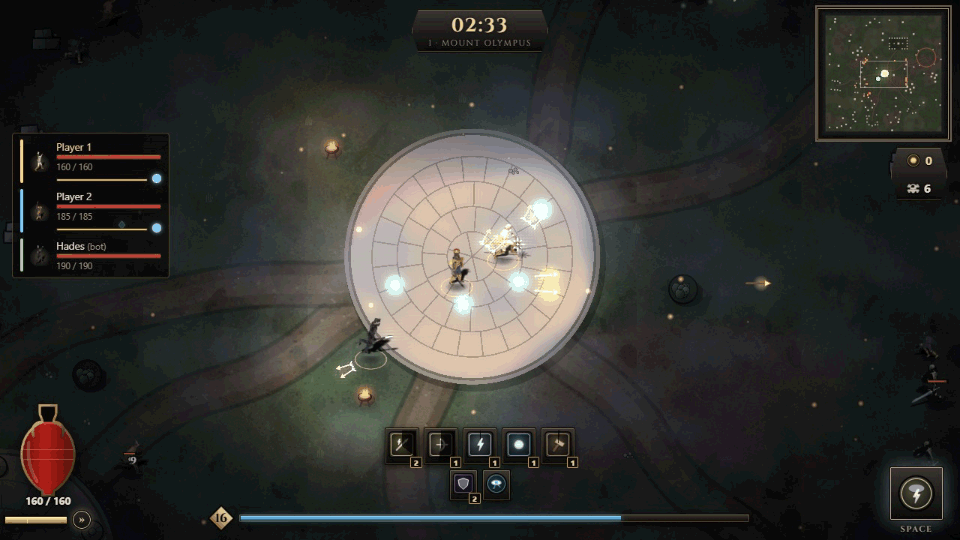

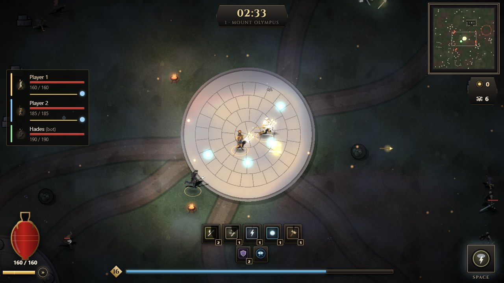

- **One camera** frames every living god, and zooms out as you spread apart. Once it is fully out, you cannot walk further apart: stay together or someone stops at the edge of the screen.
- **Choices in turn:** at a level-up, a treasure or the merchant, each player's choice is shown in turn, named (*Player 2 · Level 5!*). Any keyboard, mouse or gamepad may answer it.
- **The party panel** on the left shows every player's health, stamina and whether their ability is ready; the big HUD shows player 1.
- The rules are those of co-op rooms below: difficulty per god, reviving, the gate. Any player's Esc, P or Start pauses for everyone. Everyone here shares this machine's save and its blessings, and a run with two or more players counts as co-op for Glory.

## Co-op rooms

Up to four gods fight one horde, each player in their own browser.

- **Create a room** (*Co-op → Create room*): you get a five-character code, like `K7QXP`, to share with friends. **Join a room** with a friend's code.
- **Lobby:** everyone picks a name and a god (several players may pick the same god), and guests mark themselves *Ready*. The host picks the realm and starts once everyone is ready. The loading screen lists the party and the room code, and the run starts when everyone has loaded.
- **Together:** each camera follows its own god, or an ally after you fall. Experience and level are shared, but each player gets their own three offers and picks their own upgrade. The run waits until everyone has chosen (*Waiting for Bo to choose…*).
- **Reviving:** a fallen god's spirit floats where they fell. Stand beside it for 3 seconds (a ring fills) and they rise with half their health. Stepping away drains the ring. Passing a gate also brings every fallen god along. If every god is down at once, the run ends.
- **Difficulty per player:** every god beyond the first adds 65% enemy health, 50% more spawns and enemies alive at once, and 90% boss health.
- **Pause:** in a room, the menu does not stop the fight, and leaving the window does not pause. The host's menu offers *End run for everyone*, a guest's *Leave room*.
- **Leaving:** a guest who leaves (or loses the connection) leaves the battle, and the run goes on. If the host leaves, everyone's run ends as abandoned. Everyone keeps their own rewards in their own save. A room lasts one run; the summary offers *Co-op* to start another.
- Rooms connect browsers directly (WebRTC). A public service only introduces them; nothing is stored online. Keep the host's game visible, because browsers slow down hidden tabs.

## Night on Olympus

Runs take place at night. The arena is dark beyond your light; braziers ring the marble plazas, lightning and fire light up their surroundings, fog drifts and embers float over the field. Enemies outside the light stay visible as dim figures; telegraphs, enemy arrows and pickups are always drawn at full strength.

**Graphics quality** (Settings or the pause menu, applies at once): *Low* — fewer lights, no fog, embers, bloom or colour grading (chosen automatically without hardware graphics); *Medium*; *High* — the most lights, denser fog and embers, bloom on lightning and fire.

## Music

Every run has battle music, composed and played by the game itself: a lyre and frame drum while the realm is young (**Calm**), then war drums and bass (**Stirring**), a rock beat with power chords (**Battle**), driving metal with double kick and palm-muted riffs (**Fury**), and, while a boss is awake, the fastest and heaviest tier with a choir (**Titan**). It rises with the realm's time toward its boss, with every realm cleared and with the foes crowding around your god, and eases back down slowly when the field clears. A change waits for the end of the bar, so it lands on the beat. The music is quieter while paused, carries on through the gate, and fades out when the run ends. **Settings → Music** (also in the pause menu) sets its volume, apart from the sound effects.

## The HUD

Health fills an **amphora** (bottom left) with the gold **stamina** bar and the dash pip beneath it, the experience bar and your weapons (each with its own cooldown sweep), armour, relics and companions sit along the bottom, the divine ability waits in an iron slot (bottom right) with a dark cooldown sweep that turns smoothly, the seconds left and a flash when it is ready, the run time sits in the top plaque with the minimap at the top right and gold and kills under it, active synergies at the top left, and the boss appears in a banner under the timer.

**Health bars:** every monster that has been hurt shows a thin red bar above it (Settings → *Enemy health bars* hides them); elites keep their gold bar and the boss its banner.

**Party health** (co-op, on the left): every god in the run in their seat's colour (the same as on the minimap), with their god, name, a health bar and the numbers; your own is marked *(you)*, and a fallen god shows how far their revive has come.

**Minimap** (top right, above the gold and kills): the whole realm with its walls and the boss arena; monsters as red dots (elites larger and gold), the boss as a large red mark once it wakes, the open gate as a pale ring, the merchant as a gold diamond, every god in their own colour (yours largest, with a white rim; fallen gods as hollow rings), and the outline of what the screen shows.

## Zeus, King of the Sky

Health 120, speed 210, critical chance 13% (with his passive). Starts with **Thunder Spear**. Ability **Wrath of Olympus** (25 s): lightning strikes up to 8 nearby foes, stunning and shocking them. Passive **Thunderborn**: +10% lightning damage, +5% critical chance. Lightning items are offered more often.

## Hades, Lord of the Underworld

Health 150, speed 190, armour 2: he fights up close and outlasts the horde. Starts with the **Bident of Hades** (a forward thrust at the nearest foe that drinks 3% of its damage as life). Ability **Gates of Tartarus** (24 s): the abyss opens around him — every foe within reach is struck, held for a moment and slowed, and he heals from it. Passive **Lord of the Dead**: +15% shadow damage; heals for 1.5% of all damage dealt. Shadow and fire items are offered more often.

## Poseidon, Lord of the Sea

Health 145, speed 200, armour 1: he holds the line and keeps the horde at bay. Starts with the **Trident** (three piercing prongs with heavy knockback). Ability **Tidal Wave** (20 s): nine walls of sea-water roll out in a wide arc, crash through every foe in their path, hurl them back and leave them slowed. Passive **Earth-Shaker**: +30% knockback, +10% area, +10% physical damage. Physical and lightning items are offered more often.

## Athena, Goddess of Wisdom and War

Health 135, speed 205, armour 2, critical chance 12% (with her passive): a precise striker who controls the field. Starts with the **Spear of Athena** (a piercing bronze javelin with a high critical chance). Ability **Gorgon's Gaze** (26 s): she raises the Aegis and every foe within a wide radius is struck and turned to stone for 2.5 seconds. Passive **Wisdom of War**: +15% experience, +7% critical chance. Physical and lightning items are offered more often.

## The realms

Five realms, each with its own map, monsters and boss, in the order a run passes through them (after the Labyrinth comes Mount Olympus again, harder).

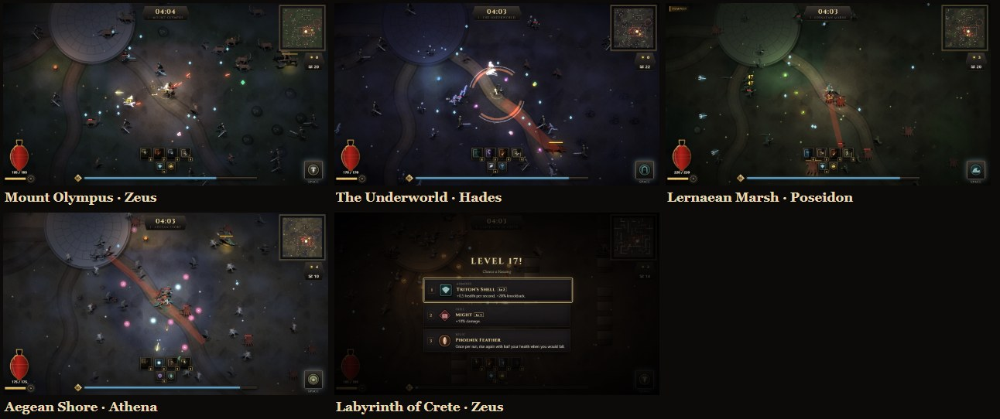

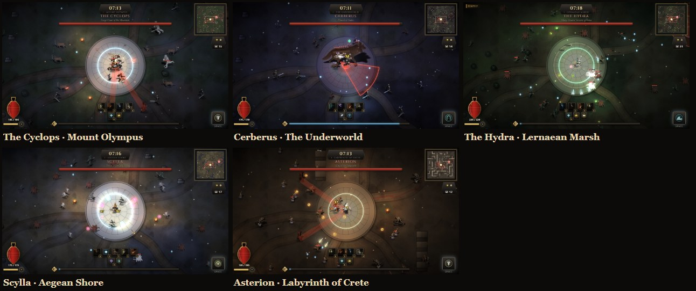

## Mount Olympus

A 64×64-tile arena (4096 px) of grass, meadow and earth ringed by cliffs, painted fresh for every seed with smooth transitions, texture and shadows. Marble plazas: the spawn plaza in the centre, ruins (rings of columns, braziers around them), and the Cyclops's arena far from the spawn. Worn dirt **roads** lead from the spawn to every ruin, to the **temple** — a stepped marble stylobate with a broken colonnade and an altar between two braziers — and to the Cyclops. **Ruined walls** with breaches, olive groves, statues, rocks and broken columns block movement and enemy arrows; roads are always open ground. Flowers, grass tufts, pebbles, rubble and marble shards are decoration only.

**Loading:** starting a run shows the realm at night, your party and a line of lore while the art loads and the realm is painted (*Summoning the gods* → *Shaping the realm* → *The horde gathers*); the run starts at 00:00 when it fades away.

| Time | What happens |
|---|---|
| 00:00 | Satyrs |
| 00:40 | Harpies; Stymphalian bird flocks |
| 01:00 | A satyr horde surrounds you |
| 01:30 | Corrupted hoplites |
| 02:00 | **Elite** corrupted hoplite |
| 02:30 | Centaur archers |
| 03:00 | A harpy horde |
| 03:30 | Minotaurs (charge after a red telegraph) |
| 04:00 | **Elite** minotaur |
| 04:30 | Fallen oracles (summon bird flocks) |
| 05:00 | A hoplite horde |
| 05:30 | Marble sentinels; **elite** centaur archer |
| 06:15 | **Elite** marble sentinel |
| 07:00 | **The Cyclops** (spawning slows) |

Enemy health and damage grow a little each minute (capped). Elites are larger and much tougher, carry a gold health bar and always drop a treasure chest (a free upgrade choice).

## The Cyclops

12,000 health. Phase 1: **Club Sweep** (two cones in front of him, one after the other, left then right), **Boulder Throw** (circles at and around you) and **Ground Slam** (a circle around him). Below 50% he **rages**: he turns red, moves faster and pauses far less, sweeps three times in a row, adds **Rampage Charge** (a marked lane, then a dash), five boulders and **Call the Legion** (hoplites). Every damaging attack is marked in red first and flashes white in its last quarter-second; only a player inside the mark when it ends is hit. A red arrow at the screen edge points to the Cyclops while it is off-screen.

**Perfect dodge:** dash so that a boss attack lands while you are untouchable (a warning resolving on you, a charge or a lash reaching you): "Perfect dodge!", your dash's stamina comes back, and you gain **Surge**, +30% damage for 3 seconds (shown above the ability slot). The white flash is the moment to dash.

## The Underworld

The fields of Asphodel beneath a sunless sky: ash, pale asphodel and basalt in a cold violet light, soul-wisps instead of embers. Black-marble plazas are ringed by obsidian columns and blue soul-fire braziers. The ruined hall of Hades keeps a black altar, and dead groves and Greek grave stelae stand among bones. It follows Mount Olympus in the chain of realms, and you can also start a run here.

| Realm time | What comes |
|---|---|
| 00:00 | **Shades**: frail, weaving spirits of the dead, in great numbers |
| 00:40 | **Furies** (the Erinyes): fast, winged avengers |
| 01:30 | The skeletal **hoplites** of Mount Olympus |
| 02:30 | **Lampads**: torch-nymphs of Hecate who keep their distance and hurl violet soul-fire |
| 03:30 | **Orthrus**: Cerberus's two-headed brother; lowers its heads, then charges |
| 07:00 | **Cerberus** (spawning slows) |

Hordes of shades and furies and elite furies, lampads and Orthrus arrive on the way, like on Olympus.

## Cerberus

The three-headed hound of Hades, with a smouldering serpent mane (13,000 health, 300 gold).
- **Three heads, three rhythms:** the left head breathes **hellfire** in a cone, the middle head **lunges** along a line, the right head rains **soul-fire** on circles under you, each on its own beat while the body pounces along a red line and bites in a circle.
- **Below half health:** it howls for the pack, calling three Orthrus; the heads and the body quicken, it bites wider and pounces faster.

## Lernaean Marsh

The poisoned swamp of Lerna: bog, mud and reedbeds around deep water in a green mist, lit by will-o'-wisps. Sunken shrines of mossy marble, a drowned temple and cypress groves stand among reeds and lily pads. It follows the Underworld in the chain of realms, and you can also start a run here.

| Realm time | What comes |
|---|---|
| 00:00 | **Swamp serpents**: the Hydra's brood; fast, weaving, numerous, later in packs |
| 00:40 | **Lamiae**: serpent-tailed; they coil, then lunge |
| 01:30 | **Giant crabs**: the brood of Karkinos; slow, tough, heavy blows |
| 02:30 | **Naiads**: nymphs of the poisoned springs who keep their distance and spit venom |
| 07:00 | **The Hydra** (spawning slows) |

## The Hydra

Five serpent necks rising from one body (15,000 health, 320 gold).
- **Cut the heads in order.** Three heads, marked **I, II, III** in gold above the one to cut next; the others are shielded (grey ring, "shielded" when hit). Each head spits venom and strikes along a line. A cut head grows back after 14 s, so finish the sequence quickly. While any head lives, her body takes only a tenth of the damage; with every head down she is **exposed** for 8 s (a white pulse) and takes 60% more, then the heads grow back.
- **Below half health:** "Cut one head and two grow back!" Two more heads (IV and V), more venom rain, a brood of serpents and a wider bite.

## Aegean Shore

Moonlit sand, dunes and sea-rock above the strait, under a cool silver light with drifting spray. Sea-worn marble temples and plazas, wrecks of Odysseus's fleet, spilled amphorae and beacon braziers line the beach among shells and seaweed. It follows the Lernaean Marsh in the chain of realms, and you can also start a run here.

| Realm time | What comes |
|---|---|
| 00:00 | **Drowned sailors**: Odysseus's lost crew; slow, relentless, later in packs |
| 00:40 | **Sirens**: they keep their distance and hurl their song (rose rings) |
| 01:30 | **Giant crabs** from the shore |
| 02:30 | **Tritons**: Poseidon's mermen; they lower their tridents, then charge |
| 07:00 | **Scylla** (spawning slows) |

## Scylla

The monster of the strait: a woman with six hounds at her waist and serpent tentacles beneath (16,000 health, 340 gold).
- **She holds the strait:** anchored near her arena, with **four tentacles** around it. Each tentacle holds a stretch of shore (a teal ring): standing in it hurts and slows you. Tentacles lash at gods who come near, can be destroyed and grow back after 20 s. While any tentacle lives, Scylla takes half damage. Her hounds bite in a circle, Charybdis opens whirlpools under you.
- **Below half health:** "The drowned answer Scylla's call!" Five drowned sailors, seven whirlpools, double sweeps of her hounds and a wider bite.

## Labyrinth of Crete

The maze Daedalus built beneath Knossos: dressed stone under warm torchlight, dust and drifting embers, no sky. Its walls run across the whole map in a maze of corridors. They stop gods and monsters alike, but walls are broken here and there and every corridor leads on. Rooms of red Minoan columns, a shrine with the bull altar and its torches, horns of consecration, bones of the tribute, straw and labrys floor tiles. **Ariadne's thread**, a red line on the ground, runs along the road from where you enter to Asterion's arena. It follows the Aegean Shore in the chain of realms (after it comes Mount Olympus again, harder), and you can also start a run here.

| Realm time | What comes |
|---|---|
| 00:00 | **Kouretes**: the armed dancers who hid the infant Zeus, now the maze's cursed guard; quick, later in packs |
| 00:40 | **Snake priestesses**: they keep their distance and hurl a curse of gold coils |
| 01:30 | **Minotaurs**: they lower their horns, then charge |
| 02:30 | **Bronze Guardians**: the kin of Talos; slow, very tough, heavy blows |
| 07:00 | **Asterion** (spawning slows) |

## Asterion

The Minotaur, king of the Labyrinth, with a bronze labrys (18,000 health, 380 gold).
- **The Labyrinth shifts:** walls rise around him in rings with gaps (stone outlines warn where), stand a while and are replaced by new ones. A god caught where a wall rises is thrown aside and hurt. His **bull rush** stops dead at a wall and leaves him **dazed** for 2.5 s (stars over his head), taking 50% more damage: lure him into the walls. His labrys sweeps in a circle and the ceiling's stones fall on you.
- **Below 60% health:** "The Labyrinth answers its king!" Three rings of walls, three minotaurs, longer rushes and more stones.
- **Below 25% health:** "Asterion goes berserk!" He rages red, the walls shift faster, and he rushes twice in every round of attacks.

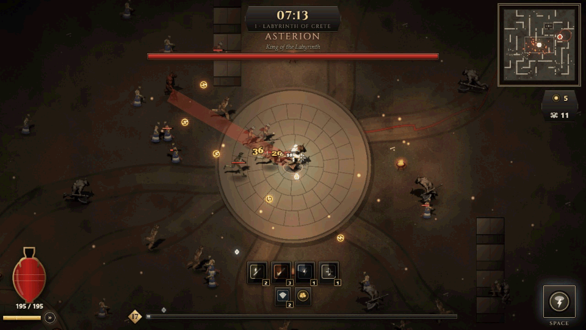

## Building a run

- **Weapons** (up to 6, levels 1–6): Thunder Spear, Divine Bow, Trident, Lightning Orb, War Hammer, Flaming Sword, Thunderbolt, Soul Scythe.
- **Armour** (1 slot, levels 1–3): Aegis of Olympus, Armour of the Underworld, Triton's Shell, Valkyrie's Plate.
- **Relics** (up to 4): Zeus's Eye, Soul Lantern, Golden Fleece, Trident Fragment, Phoenix Feather, Eye of Horus.
- **Skills** (stackable): Might, Swiftness, Haste, Multishot, Reach, Vitality, Bulwark, Magnetism, Wisdom of Athena, Precision, Lingering Power, Storm Caller, Forked Lightning, Fury of Flames, Titan's Strength, Shadow Pact. Element skills appear only when you wield that element.
- **Synergies** activate automatically and are announced: **Storm**, **Tempest**, **Inferno**, **Soul Reaper**, **Divine Bulwark**, **Wrath of the Sky**, **Earthshaker** (requirements in [content.md](content.md)).
- When nothing is left to offer: **Ambrosia** (heal 30%) or **Tribute** (25 gold).

## The Wandering Merchant

| The shop | Companions fighting, and a dash |
|---|---|
| 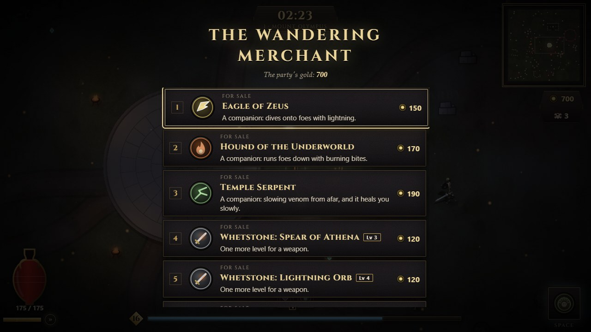 | 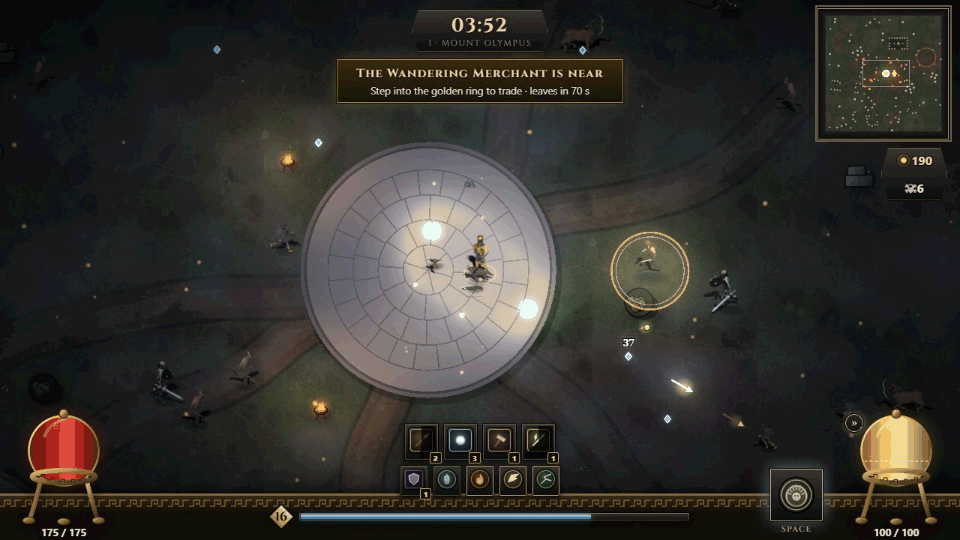 |

Twice in every realm (at 2:30 and 5:30) a merchant arrives a short walk from the party, announced, marked on the minimap and by a gold arrow at the screen's edge, lit by a lantern and standing in a golden ring. A banner counts down the 75 seconds until it leaves. Step into the ring to trade (the run pauses; in a room the others wait). Prices are in the run's gold (in a room, the party's shared purse) and grow by half for every realm cleared; what you spend no longer counts toward the gold you keep. Leave the shop and it opens again only when you step out and back in.

| Ware | Price | What it does |
|---|---|---|
| Eagle of Zeus | 150 | a companion that dives onto foes in a lightning blast (shock) |
| Hound of the Underworld | 170 | a companion that runs foes down and bites in a burning arc |
| Temple Serpent | 190 | a companion that spits slowing venom from afar and heals you 1.5 per second |
| Whetstone | 120 | one more level for a weapon you choose (one offer per weapon below its maximum) |
| Ambrosia | 60 | heals 40% of your health (only offered when hurt) |

**Companions** hunt foes near their god, cannot be hurt, follow you through gates and wait where you fall. Their hits count as yours (your might, critical chance and element bonuses apply). Up to three, one of each.

## Rewards and progression

- Gold collected in the run is kept when you fall, including each boss's gold (**+250** for the Cyclops); **half** (rounded down) when abandoned.
- Weapons, armour and relics held at the end become **discovered** in the codex.
- **Permanent upgrades**: Vitality, Might, Swiftness, Greed, Attraction, Resilience.
- Statistics: runs, realms cleared, total kills, best survival time.

## Glory

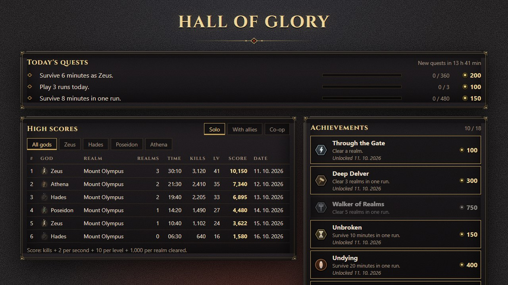

Every run earns a **score**: kills + 2 per second survived + 10 per level + 1,000 per realm cleared. The **Hall of Glory** (main menu → Glory) keeps the ten best solo runs and, apart from them, the ten best co-op runs, with a filter per god.

**Achievements** (18) pay gold once: clear a realm, clear 3 or 5 in one run, survive 10 or 20 minutes, slay 1,000 in a run or 1,000 / 10,000 over all runs, reach level 30, two synergies at once, 1,500 gold in a run, 25 runs, two realms with each god, a realm with every god, a realm in co-op.

**Daily quests**: three a day, the same for everyone on that date, at most one for a particular god; progress adds up over the day's runs (or counts the day's best run), each pays gold once, and new ones come at local midnight. The main menu shows how many are done. The run summary lists the score, a new high score, and achievements and quests completed with their gold.

## Admin mode

Open `/admin` directly (nothing links to it) and give the admin password (any build; it stays unlocked for the tab's session; change it with `node scripts/admin-password.mjs "<new password>"`, which stores only its SHA-256 hash; a static game cannot truly hide it, so it keeps players out rather than attackers). The screen shows statistics over this browser's last 100 runs (totals, a table per god, where runs ended, which weapons end up in builds and their share of damage, a chart of the latest scores), export of the history as JSON or CSV, and a **balance report**: the bot plays chosen gods from a fresh start for a chosen number of runs and minutes on a chosen realm, in the page, and tabulates realms cleared, level, kills, time and weapons. Same choices, same report. Nothing is sent anywhere.

## Feedback

Hit flashes, health bars over hurt monsters and damage numbers (critical hits larger and gold), status tints (burn orange, shock blue, slow violet, stun yellow), particles on hits and deaths, shockwaves, sword arcs, chain lightning, lightning strikes, screen shake (optional), and synthesized sound.

**Sound** (recorded, CC0):
- Every weapon and every god's ability sounds like what it is:
  - Zeus's Wrath of Olympus is a real lightning crack and a rolling thunderstorm; the thunderbolt cracks and claps, and the spear crackles.
  - Poseidon's Tidal Wave is surging, crashing water; the trident splashes and rings.
  - Athena's Gorgon's Gaze shimmers like ice, then stone cracks; her spear swishes and rings.
  - Hades's Gates of Tartarus is a deep fire roar with breaking stone.
  - The hammer is heavy blows on stone; the flaming sword is a blade swish in a burst of fire.
- Hits sound by element (a thud, a crackle, a sizzle, a hiss). Kills are punchy, and an elite's or a boss's death is heavy.
- Your own wounds thud low and clear.
- Each boss attack has its wind-up: a swell before a slam, a rumble before falling stones, a bellow before a rush, a horn when it summons.
- Reviving, the gate opening and entering a new realm have their own chords; pickups, level-ups and synergies chime.
- Sounds are placed: a hit on the right of the screen is heard on the right, and things far off-screen fade out. A limiter keeps the biggest fights from clipping.
