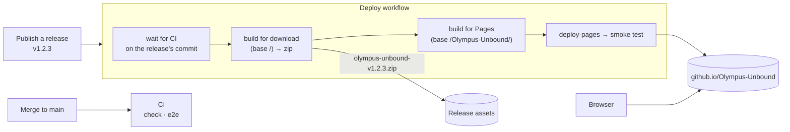
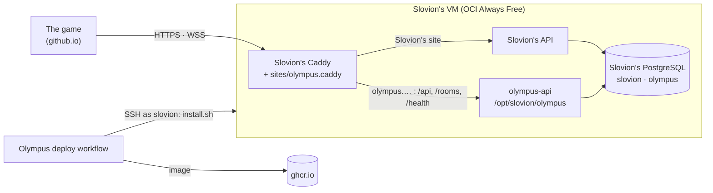

# Hosting

OLYMPUS UNBOUND is a static site (D1). Each published GitHub Release goes live on **GitHub Pages** at **https://david-letonja-ctg.github.io/Olympus-Unbound/**, and the built game is attached to the release as a zip anyone can host.

Co-op rooms, the open rooms and the world boards go through the **game server** (D21). It runs on Slovion's Oracle Cloud VM, sharing its Caddy and PostgreSQL, and is deployed by the same releases ([The game server](#the-game-server)). Until the server is set up, releases publish the game without co-op and world boards.

- [How it fits together](#how-it-fits-together)
- [One-time setup](#one-time-setup)
- [Releasing](#releasing)
- [Hosting the zip elsewhere](#hosting-the-zip-elsewhere)
- [Troubleshooting](#troubleshooting)
- [The game server](#the-game-server)

## How it fits together



| Piece | Where it is defined |
|---|---|
| CI (every push and pull request) | [`.github/workflows/ci.yml`](../.github/workflows/ci.yml) |
| Deploy (on releases) | [`.github/workflows/deploy.yml`](../.github/workflows/deploy.yml) |
| The build | `npm run build` in `client/`, with `--base-href` for where the site lives |

- **Paths:** Pages serves a project site under `/Olympus-Unbound/`, so the app never refers to files from the site root. Code loads `assets/...` relative to the `<base href>`, and the global styles reference their fonts and frames from `public/`, so the build bundles them with relative URLs.
- **Deep links:** a link such as `/Olympus-Unbound/play` has no file behind it. Pages answers with `404.html`, which the build makes a copy of `index.html`, so the app starts and its router takes over. The addresses players send each other (`challenge`, `coop`, `daily`) get their own copies (`challenge.html` and so on, made by `scripts/entry-pages.mjs`): Pages serves them for `/challenge?…` with 200 OK, and chat apps only show a link preview for a page that is found.
- **Link preview (D19):** `index.html` names `https://david-letonja-ctg.github.io/Olympus-Unbound/og-image.jpg` and the same address for `og:url`, absolute as previews require. A fork or another host should change both (in `client/src/index.html`).
- **Installed and offline (D18):** the production build contains `ngsw-worker.js` and `ngsw.json`, the service worker's list of every file with its hash, and a `manifest.webmanifest` with relative paths. After a visit, the browser keeps the whole game.
  - A new release is noticed at the next launch, or within 30 minutes, and downloaded in the background. The main menu then offers to reload.
  - Files are content-hashed, so a version never mixes files of another.
  - Any host works, as long as it serves `ngsw.json` and the worker from the build's folder.

## One-time setup

Already done for this repository (2026-10-12); repeat it only for a fork or a new repository.

1. The repository is **public**: Pages for a private repository needs a paid GitHub plan.
2. *Settings → Pages → Build and deployment → Source:* **GitHub Actions**.
3. *Settings → Environments → github-pages → Deployment branches and tags:* add the tag rule **`v*`**. Releases deploy from their tag, and the environment allows only `main` by default.

With the GitHub CLI, the same:

```bash
gh api -X POST repos/OWNER/REPO/pages -f build_type=workflow
gh api -X POST repos/OWNER/REPO/environments/github-pages/deployment-branch-policies -f name='v*' -f type=tag
```

## Releasing

Merging into `main` only runs CI. The game goes live by **publishing a release**:

```bash
gh release create v0.1.0 --generate-notes        # or GitHub → Releases → Draft a new release
```

- Version tags look like `v1.2.3`: raise the last number for fixes, the middle one for new features, the first for big changes.
- A release marked as a **pre-release** doesn't deploy.
- The release's commit must be on `main` with a passing CI run; the workflow waits for a CI run still in progress.

When a release is published, the **Deploy** workflow:

1. checks the tag and waits for CI on its commit;
2. builds the game for the root of any host and attaches it to the release as `olympus-unbound-<version>.zip`;
3. builds it again for Pages (`--base-href /Olympus-Unbound/`, plus `404.html` and the shared addresses' pages) and deploys it;
4. smoke-tests the site: the page, a sprite sheet and a deep link must answer.

**By hand:** *Actions → Deploy → Run workflow* with a version tag redeploys that version, for example to roll back to an older release.

Saves live in each player's browser (`localStorage`, per site), so a new version keeps everyone's progress. Older saves are migrated (D8).

## Hosting the zip elsewhere

The zip is the game for the root of a static host: unzip it and serve the folder.

- **Locally:** `npx serve -s .` (the `-s` makes unknown paths serve the app).
- **Any static host** (Netlify, Cloudflare Pages, an nginx or Caddy server): point it at the folder, and make unknown paths serve `index.html`, or `404.html` where the host uses that.
- **Under a sub-path:** build it yourself with `npx ng build --base-href /your/path/` in `client/`.

## Troubleshooting

| Symptom | Cause and fix |
|---|---|
| Deploy fails with *not allowed to deploy to github-pages due to environment protection rules* | The `v*` tag rule is missing from the `github-pages` environment (one-time setup, step 3). |
| Deploy fails with *Get Pages site failed* or *Not Found* | Pages is not enabled with the GitHub Actions source (one-time setup, step 2). |
| *no CI run on main for …* | The tag points at a commit that is not on `main`. Release from `main`. |
| The site loads but shows no fonts, frames or art | Something refers to a file from the site root (`/…`). Load files relative to the base href (`assets/…`) or from `public/` in styles. |
| Players keep an old version | Their game has not checked yet, or they have not tapped *Reload* on the menu's notice. A check runs at every launch. In an emergency, deleting `ngsw.json` from the site makes the worker step aside on the next visit. |
| A reload on `/play` shows GitHub's 404 page | `404.html` is missing from the build; `scripts/entry-pages.mjs` copies it from `index.html`. |
| A pasted challenge link shows no preview | The address answers 404: `challenge.html` is missing, or the route is not in `scripts/entry-pages.mjs`. |

## The game server

The game server (D21) runs on **Slovion's VM** (an Oracle Cloud Always Free Arm VM), next to Slovion, and shares its Caddy and its PostgreSQL server (Slovion's D12, revised 2026-10-22):

- **Container:** `olympus-api` in `/opt/slovion/olympus`, on Slovion's stack network (`slovion_default`).
- **Database:** `olympus`, with its own `olympus` role, on Slovion's PostgreSQL. Slovion's daily backup dumps it too.
- **Address:** `olympus.138-2-144-201.sslip.io`, the VM's IP through sslip.io, with its own HTTPS certificate. Slovion's Caddy serves it from `/opt/slovion/sites/olympus.caddy`.



| Piece | Where it is defined |
|---|---|
| API image | [`deploy/api.Dockerfile`](../deploy/api.Dockerfile) |
| The container on the VM | [`deploy/compose.yml`](../deploy/compose.yml) |
| Its site in Slovion's Caddy | [`deploy/olympus.caddy`](../deploy/olympus.caddy) |
| Install or update on the VM: database role and database, container, site, Caddy reload | [`deploy/install.sh`](../deploy/install.sh) |
| A stand-in Slovion stack for testing `install.sh` | [`deploy/test/`](../deploy/test/) |
| Smoke test (CI, deploys, by hand) | [`deploy/smoke-test.sh`](../deploy/smoke-test.sh) |

### Configuration

| Name | Kind | What it is |
|---|---|---|
| `SERVER_ADDRESS` | repository variable | `olympus.138-2-144-201.sslip.io`. Setting it turns the server deploy on, and the game is built to use it |
| `DEPLOY_HOST` | `production` secret | the VM's IP (as Slovion's) |
| `DEPLOY_USER` | `production` secret | `slovion`: Slovion's deploy user, in the `docker` group |
| `DEPLOY_SSH_KEY` | `production` secret | Olympus's own deploy key, authorized for `slovion` on the VM |
| `DEPLOY_KNOWN_HOSTS` | `production` secret | the VM's SSH host keys (`ssh-keyscan`) |
| `POSTGRES_PASSWORD` | `production` secret | the `olympus` role's password (12+ letters and digits). `install.sh` sets it on every deploy |
| `ADMIN_TOKEN` | `production` secret | hides world board entries |

`ALLOWED_ORIGINS` is set by the workflow to `https://<owner>.github.io`: only the game's site may call the server from a browser.

### One-time setup

1. **Slovion first:** Slovion's release with the shared-VM support (Slovion's `sites/` import, admin endpoint inside the container, backups of every database) must be live on the VM.
2. **A deploy key for Olympus,** authorized for Slovion's deploy user. Log in as `ubuntu` with your own key:
   ```bash
   ssh-keygen -t ed25519 -N "" -C olympus-deploy -f olympus-deploy
   ssh ubuntu@138.2.144.201 "sudo tee -a /home/slovion/.ssh/authorized_keys" < olympus-deploy.pub
   ```
3. **The GitHub settings:**
   ```bash
   repo=David-Letonja-CTG/Olympus-Unbound
   gh api -X PUT "repos/$repo/environments/production" > /dev/null
   gh secret set DEPLOY_HOST        --env production --repo $repo --body 138.2.144.201
   gh secret set DEPLOY_USER        --env production --repo $repo --body slovion
   gh secret set DEPLOY_SSH_KEY     --env production --repo $repo < olympus-deploy
   ssh-keyscan -t ed25519,ecdsa,rsa 138.2.144.201 2>/dev/null | gh secret set DEPLOY_KNOWN_HOSTS --env production --repo $repo
   openssl rand -hex 24 | gh secret set POSTGRES_PASSWORD --env production --repo $repo
   openssl rand -hex 24 | gh secret set ADMIN_TOKEN       --env production --repo $repo
   gh variable set SERVER_ADDRESS   --repo $repo --body olympus.138-2-144-201.sslip.io
   rm olympus-deploy olympus-deploy.pub
   ```
4. **Publish a release.**
   - **Server first:** the server deploys through `install.sh`, with a health check, a smoke test and a rollback on failure.
   - **Then the game** goes to Pages, built with `https://SERVER_ADDRESS`.

### Operations

- **Logs:** `ssh slovion@138.2.144.201 'cd /opt/slovion/olympus && docker compose logs --tail 200 olympus-api'`
- **Hide an entry:** `curl -X POST -H "Authorization: Bearer $ADMIN_TOKEN" https://olympus.138-2-144-201.sslip.io/api/admin/scores/<id>/hide`. The id is in `/api/leaderboards/<board>`.
- **Backups:** Slovion's daily backup dumps `olympus` as `/opt/slovion/backups/olympus-<time>.dump` and uploads it to Slovion's bucket.
- **Restore a backup:** `docker exec -i slovion-db-1 pg_restore -U slovion -d olympus --clean --if-exists < olympus-<time>.dump`
- **Locally,** without a database: `cd server && npm run serve`. Or run the VM's setup against a stand-in Slovion stack, as CI does:
  ```bash
  docker build -f deploy/api.Dockerfile -t local/olympus-api:test .
  SITES_DIR=/tmp/slovion/sites docker compose -f deploy/test/slovion.compose.yml up -d --wait
  # copy compose.yml, olympus.caddy, install.sh to a folder with a .env (IMAGE_PREFIX=local, TAG=test,
  # POSTGRES_PASSWORD, OLYMPUS_ADDRESS=:80, SLOVION_DIR=/tmp/slovion), then:
  bash install.sh && bash deploy/smoke-test.sh http://localhost:8080
  ```
- **Downloaded builds:** the zip attached to a release has no server address. Hosted elsewhere, it would be another site, which the server does not allow.
