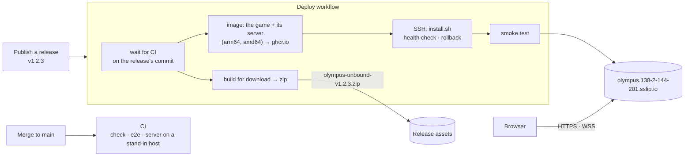
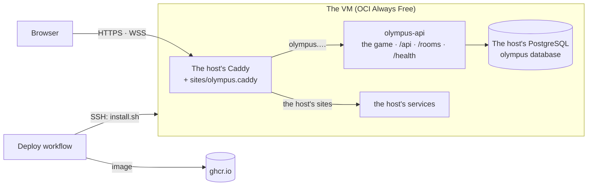

# Hosting

OLYMPUS UNBOUND lives at **https://olympus.138-2-144-201.sslip.io/**. One service there, the **game server** (D21), serves the game's files, its API (world boards, open rooms) and its co-op rooms, from an Oracle Cloud VM it shares with another stack. Each published GitHub Release goes live there, and the built game is attached to the release as a zip anyone can host.

- [How it fits together](#how-it-fits-together)
- [Releasing](#releasing)
- [The VM](#the-vm)
- [One-time setup](#one-time-setup)
- [Operations](#operations)
- [Hosting the zip elsewhere](#hosting-the-zip-elsewhere)
- [Troubleshooting](#troubleshooting)

## How it fits together



| Piece | Where it is defined |
|---|---|
| CI (every push and pull request) | [`.github/workflows/ci.yml`](../.github/workflows/ci.yml) |
| Deploy (on releases) | [`.github/workflows/deploy.yml`](../.github/workflows/deploy.yml) |
| The image: the game built for its own address, and the server | [`deploy/api.Dockerfile`](../deploy/api.Dockerfile) |
| The container on the VM | [`deploy/compose.yml`](../deploy/compose.yml) |
| Its site in the host's Caddy | [`deploy/olympus.caddy`](../deploy/olympus.caddy) |
| Install or update on the VM: database role and database, container, site, Caddy reload | [`deploy/install.sh`](../deploy/install.sh) |
| A stand-in host stack for testing `install.sh` | [`deploy/test/`](../deploy/test/) |
| Smoke test (CI, deploys, by hand) | [`deploy/smoke-test.sh`](../deploy/smoke-test.sh) |

- **One address:** the game is built with `OLYMPUS_SERVER='same-origin'`, so it calls the server at its own address. No CORS, and the WebSocket's origin is the game's.
- **Deep links:** a path with no file behind it (`/play`) gets the game, whose router takes over. The addresses players send each other (`challenge`, `coop`, `daily`) get their own pages (`challenge.html` and so on, made by `scripts/entry-pages.mjs`) with 200 OK, since chat apps only show a link preview for a page that is found. A missing file with an extension is a real 404.
- **Link preview (D19):** `client/src/index.html` names `https://olympus.138-2-144-201.sslip.io/og-image.jpg` and the same address for `og:url`, absolute as previews require. A new address changes both.
- **Caching:** content-hashed bundles are cached for good; everything else (pages, `ngsw.json`, assets) is revalidated, so a release shows at the next check.
- **Installed and offline (D18):** the build contains `ngsw-worker.js` and `ngsw.json`, the service worker's list of every file with its hash, and a `manifest.webmanifest` with relative paths. After a visit, the browser keeps the whole game.
  - A new release is noticed at the next launch, or within 30 minutes, and downloaded in the background. The main menu then offers to reload.
  - Files are content-hashed, so a version never mixes files of another.

## Releasing

Merging into `main` only runs CI. The game goes live by **publishing a release**:

```bash
gh release create v0.1.0 --generate-notes        # or GitHub → Releases → Draft a new release
```

- Version tags look like `v1.2.3`: raise the last number for fixes, the middle one for new features, the first for big changes.
- A release marked as a **pre-release** doesn't deploy.
- The release's commit must be on `main` with a passing CI run; the workflow waits for a CI run still in progress.

When a release is published, the **Deploy** workflow:

1. checks the tag and waits for CI on its commit;
2. builds the game for the root of any host and attaches it to the release as `olympus-unbound-<version>.zip`;
3. builds the image (the game and its server) and pushes it to `ghcr.io`;
4. installs it on the VM with `install.sh`, waits for `/health`, and rolls back to the previous version if it never answers;
5. smoke-tests the site: the game, its deep links and shared pages, caching, the API, a room, and the 404s. The test's own world board entry is hidden again with the admin token.

**By hand:** *Actions → Deploy → Run workflow* with a version tag redeploys that version, for example to roll back to an older release.

Saves live in each player's browser (`localStorage`, per site), so a new version keeps everyone's progress. Older saves are migrated (D8).

## The VM

The game server runs on an Oracle Cloud Always Free Arm VM next to another stack (the *host stack*), and shares that stack's Caddy and PostgreSQL server:

- **Container:** `olympus-api` (compose project `olympus`) in the deploy user's `~/olympus`, on the host stack's network.
- **Database:** `olympus`, with its own `olympus` role, on the host's PostgreSQL. The host's daily backup dumps it too.
- **Address:** `olympus.138-2-144-201.sslip.io`, the VM's IP through sslip.io, with its own HTTPS certificate. The host's Caddy imports its site from `<HOST_DIR>/sites/olympus.caddy`.



### Configuration

Nothing about the host stack is in this repository: the workflow reads it from GitHub settings.

| Name | Kind | What it is |
|---|---|---|
| `SERVER_ADDRESS` | repository variable | `olympus.138-2-144-201.sslip.io` |
| `HOST_DIR` | `production` variable | the host stack's directory, whose `sites/` its Caddy imports |
| `HOST_PROJECT` | `production` variable | the host stack's compose project: its containers are `<project>-db-1` and `<project>-web-1`, its network `<project>_default` |
| `HOST_DB_USER` | `production` variable | the host PostgreSQL's superuser |
| `DEPLOY_HOST` | `production` secret | the VM's IP |
| `DEPLOY_USER` | `production` secret | the VM's deploy user, in the `docker` group |
| `DEPLOY_SSH_KEY` | `production` secret | this repository's own deploy key, authorized for that user |
| `DEPLOY_KNOWN_HOSTS` | `production` secret | the VM's SSH host keys (`ssh-keyscan`) |
| `POSTGRES_PASSWORD` | `production` secret | the `olympus` role's password (12+ letters and digits). `install.sh` sets it on every deploy |
| `ADMIN_TOKEN` | `production` secret | hides world board entries and sets the difficulty dial (the admin page asks for it) |

`ALLOWED_ORIGINS` is set by the workflow to `https://<SERVER_ADDRESS>`: only the game's own site may call the server from a browser. Clients that are no browser send no origin and are let in.

## One-time setup

Already done for this repository (2026-10-22); repeat it only for a fork or a new VM.

1. **The host stack** runs on the VM: a Caddy that imports `sites/*.caddy` and has its admin endpoint inside its container, and a PostgreSQL whose backup covers every database.
2. **A deploy key,** authorized for the host's deploy user. Log in with your own key:
   ```bash
   ssh-keygen -t ed25519 -N "" -C olympus-deploy -f olympus-deploy
   ssh <admin>@<vm> "sudo tee -a /home/<deploy user>/.ssh/authorized_keys" < olympus-deploy.pub
   ```
3. **The GitHub settings:**
   ```bash
   repo=David-Letonja-CTG/Olympus-Unbound
   gh api -X PUT "repos/$repo/environments/production" > /dev/null
   gh secret set DEPLOY_HOST        --env production --repo $repo --body <vm ip>
   gh secret set DEPLOY_USER        --env production --repo $repo --body <deploy user>
   gh secret set DEPLOY_SSH_KEY     --env production --repo $repo < olympus-deploy
   ssh-keyscan -t ed25519,ecdsa,rsa <vm ip> 2>/dev/null | gh secret set DEPLOY_KNOWN_HOSTS --env production --repo $repo
   openssl rand -hex 24 | gh secret set POSTGRES_PASSWORD --env production --repo $repo
   openssl rand -hex 24 | gh secret set ADMIN_TOKEN       --env production --repo $repo
   gh variable set HOST_DIR         --env production --repo $repo --body <host stack directory>
   gh variable set HOST_PROJECT     --env production --repo $repo --body <host compose project>
   gh variable set HOST_DB_USER     --env production --repo $repo --body <host PostgreSQL superuser>
   gh variable set SERVER_ADDRESS   --repo $repo --body olympus.138-2-144-201.sslip.io
   rm olympus-deploy olympus-deploy.pub
   ```
4. **Publish a release.**

## Operations

- **Logs:** `ssh <deploy user>@<vm> 'cd ~/olympus && docker compose logs --tail 200 olympus-api'`
- **Hide an entry:** `curl -X POST -H "Authorization: Bearer $ADMIN_TOKEN" https://olympus.138-2-144-201.sslip.io/api/admin/scores/<id>/hide`. The id is in `/api/leaderboards/<board>`.
- **The difficulty dial** (D23): the admin page's *Difficulty for every player* saves it with `ADMIN_TOKEN`. A secret cannot be read back, so to use it, set one you know: `gh secret set ADMIN_TOKEN --env production --repo $repo` (type it), then redeploy (publish a release, or *Actions → Deploy → Run workflow*). From a shell: `curl -X POST -H "Authorization: Bearer $ADMIN_TOKEN" -H 'content-type: application/json' -d '{"enemyHealth":1.2,"enemyDamage":1.1,"spawnRate":1,"realmGrowth":1.15}' https://olympus.138-2-144-201.sslip.io/api/admin/difficulty`.
- **Backups:** the host's daily backup dumps `olympus` with the other databases.
- **Restore a backup:** `docker exec -i <project>-db-1 pg_restore -U <superuser> -d olympus --clean --if-exists < olympus-<time>.dump`
- **Locally,** without a database: `cd server && npm run serve`. Or run the VM's setup against a stand-in host stack, as CI does:
  ```bash
  docker build -f deploy/api.Dockerfile -t local/olympus-api:test .
  SITES_DIR=/tmp/host/sites docker compose -f deploy/test/host.compose.yml up -d --wait
  # copy compose.yml, olympus.caddy, install.sh to a folder with a .env (IMAGE_PREFIX=local, TAG=test,
  # POSTGRES_PASSWORD, OLYMPUS_ADDRESS=:80, HOST_DIR=/tmp/host, HOST_PROJECT=host, HOST_DB_USER=host,
  # HOST_NETWORK=host_default), then:
  bash install.sh && bash deploy/smoke-test.sh http://localhost:8080
  ```

## Hosting the zip elsewhere

The zip is the game for the root of a static host, without the server: solo play, local co-op and the browser's own boards, but no rooms or world boards (the server only accepts its own site). Unzip it and serve the folder.

- **Locally:** `npx serve -s .` (the `-s` makes unknown paths serve the app).
- **Any static host** (Netlify, Cloudflare Pages, an nginx or Caddy server): point it at the folder, and make unknown paths serve `index.html`, or `404.html` where the host uses that.
- **Under a sub-path:** build it yourself with `npx ng build --base-href /your/path/` in `client/`.

## Troubleshooting

| Symptom | Cause and fix |
|---|---|
| *no CI run on main for …* | The tag points at a commit that is not on `main`. Release from `main`. |
| Deploy fails at *Wait for the health check* | The container did not start; the rollback step prints its logs. The previous version is running again. |
| The smoke test's room check times out | The rooms WebSocket is refused: check `ALLOWED_ORIGINS` and the server's logs. |
| Players keep an old version | Their game has not checked yet, or they have not tapped *Reload* on the menu's notice. A check runs at every launch. In an emergency, deleting `ngsw.json` from the site makes the worker step aside on the next visit. |
| A pasted challenge link shows no preview | The address answers 404: `challenge.html` is missing, or the route is not in `scripts/entry-pages.mjs`. |
